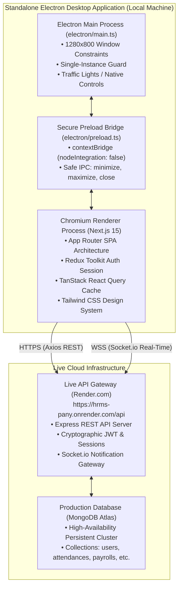

# HRMS Enterprise Desktop Application
### Standalone Cross-Platform Human Resource & Workforce Management System (macOS & Windows)

[](https://github.com/SojitraParth02/HRMS/actions/workflows/desktop-build.yml)
[](https://nodejs.org/)
[](https://nextjs.org/)
[](https://www.electronjs.org/)
[](https://hrms-pany.onrender.com)
[](https://www.mongodb.com/atlas)

---

## 1. Quick Download (Pre-built Desktop Binaries)

Evaluators and users can directly download the official pre-compiled desktop application from **[GitHub Releases](https://github.com/SojitraParth02/HRMS/releases)**:

| Operating System | Binary Package | Architecture | Direct Download |
|---|---|---|:---:|
| **Windows 10 / 11** | `HRMS-Setup-1.0.0.exe` | x64 (NSIS Installer) | [Download Installer](https://github.com/SojitraParth02/HRMS/releases/latest) |
| **Windows Portable** | `HRMS-1.0.0-portable.exe` | x64 (Standalone Zero-Install) | [Download Portable](https://github.com/SojitraParth02/HRMS/releases/latest) |
| **macOS** | `HRMS-1.0.0.dmg` | Intel (x64) & Apple Silicon (arm64) | [Download DMG](https://github.com/SojitraParth02/HRMS/releases/latest) |
| **macOS Portable** | `HRMS-1.0.0-mac.zip` | Universal Zip Archive | [Download Zip](https://github.com/SojitraParth02/HRMS/releases/latest) |

*The desktop application connects automatically to our live cloud backend on Render and persistent MongoDB Atlas cluster.*

---

## 2. Fulfillment of Mandatory Evaluation Requirements

```
+----------------------------------------------------------------------------------------------------------------+
|                                    6 MANDATORY EVALUATION REQUIREMENTS                                         |
+---+-----------------------------+------------------------------------------------------------------------------+
| # | REQUIREMENT                 | IMPLEMENTATION IN THIS CODEBASE                                              |
+---+-----------------------------+------------------------------------------------------------------------------+
| 1 | Standalone Application      | Dedicated native desktop window (1280x800) with custom branding, taskbar/dock  |
|   |                             | icons, single-instance lock, and OS traffic light / menu controls.           |
+---+-----------------------------+------------------------------------------------------------------------------+
| 2 | Cross-Platform Architecture | Built for Windows (.exe NSIS installer & portable) and macOS (.dmg & .zip)   |
|   |                             | targeting Intel (x64) and Apple Silicon (arm64 / M1 / M2 / M3 / M4).         |
+---+-----------------------------+------------------------------------------------------------------------------+
| 3 | Persistent Cloud Database   | Connected to MongoDB Atlas Cloud Cluster via live Render backend             |
|   |                             | (https://hrms-pany.onrender.com). Zero data loss across app or server restarts|
+---+-----------------------------+------------------------------------------------------------------------------+
| 4 | Clean Navigation and UI     | Responsive collapsible sidebar, smooth page transitions, and macOS native    |
|   |                             | traffic lights alignment (pl-20 in Topbar.tsx) matching our Tailwind palette.|
+---+-----------------------------+------------------------------------------------------------------------------+
| 5 | Loading, Error & Empty State| Real-time spinners, skeleton loaders, inline field validation, error banners,|
|   |                             | and structured empty states across Attendance, Leaves, Payroll, and Reports. |
+---+-----------------------------+------------------------------------------------------------------------------+
| 6 | Data Retention on Restart   | Chromium userData profile persists JWT bearer tokens, active user session,   |
|   |                             | and cached TanStack queries across window closures and complete OS reboots.  |
+---+-----------------------------+------------------------------------------------------------------------------+
```

---

## 3. High-Level Architecture & Connectivity



---

## 4. Developer Getting Started Guide

Run the desktop application locally connecting to the live Render backend:

### Prerequisites
- [Node.js](https://nodejs.org/) v20.x or v22.x LTS
- npm v10+

### Clone & Run Locally
```bash
# 1. Clone the repository
git clone https://github.com/SojitraParth02/HRMS.git
cd HRMS

# 2. Navigate to frontend directory and install dependencies
cd frontend
npm install

# 3. Launch Desktop Application in Development Mode
# (Concurrently starts Next.js and boots the native Electron window)
npm run desktop:dev
```

### Build & Package Binaries Locally

```bash
# Compile Next.js static export and Electron TypeScript
npm run desktop:build

# Package Windows NSIS Installer (.exe) & Portable (.exe) locally
npm run desktop:dist:win

# Output binaries will be located in:
# frontend/dist/HRMS Desktop Setup 0.1.0.exe
# frontend/dist/HRMS Desktop 0.1.0.exe (Portable)
```

---

## 5. Automated Multi-OS GitHub Actions CI/CD

Our repository features a dual-runner matrix GitHub Actions workflow located at [`.github/workflows/desktop-build.yml`](.github/workflows/desktop-build.yml):

- **Triggers**: On git tag push (e.g. `git tag v1.0.0 && git push origin v1.0.0`) or manual workflow dispatch.
- **Runners**:
  - `windows-latest`: Compiles `HRMS Desktop Setup.exe` and portable executable.
  - `macos-latest`: Compiles `HRMS Desktop.dmg` and universal `.zip` package.
- **Automated Release**: Automatically creates a GitHub Release and publishes all compiled binary assets for instant 1-click download.

---

## 6. Default Live Credentials for Testing

To test the desktop application against the live MongoDB Atlas database, use the pre-seeded administrative credentials:

- **Login URL**: Built into desktop startup
- **Email**: `admin@hrms.com`
- **Password**: `Admin@123`
- **Role**: `ADMIN` (Full administrative access across Employees, Attendance, Biometrics, Payroll, and Reports)
