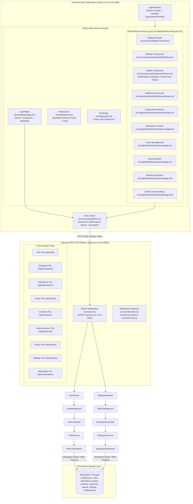
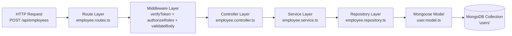
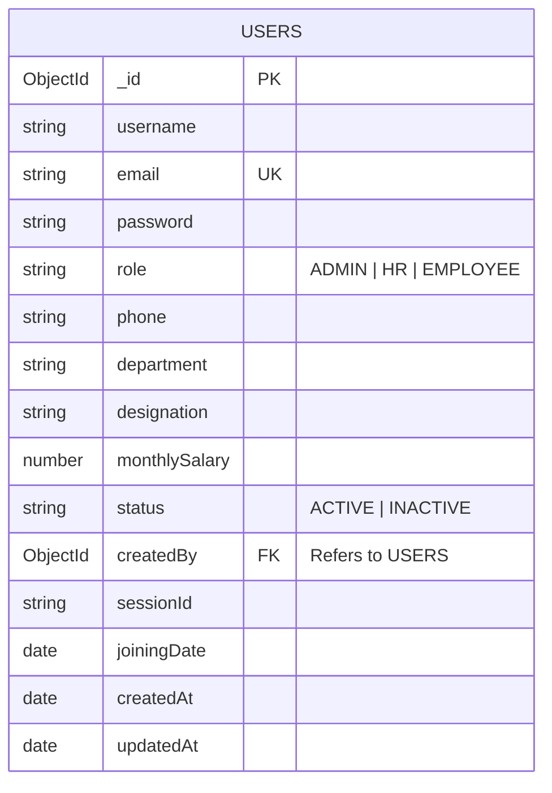

# System Architecture Documentation (Living Technical Specification)
## HRMS Workforce Management System

---

- **Document Version**: `0.20.0-comprehensive-system-audit`
- **Living Status**: `Active Baseline Specification`
- **Operating Environments**: Cross-Platform Desktop (Windows / macOS via Chromium/Electron Runtime), Web Client
- **Author**: Principal Software Architect & Full-Stack Core Team
- **Root Directory**: `d:\HRMS`
- **Last Audited & Verified**: November 20, 2026

---

## 1. Living Document Maintenance Policy & Architectural Scope

> ### ⚠️ Mandatory Living Document Mandate
> **This is a living technical specification.** It strictly reflects the **live, currently implemented codebase**. No future, hypothetical, planned, or unbuilt modules (such as Biometric CSV parsing, automated payroll calculation engines, or payslip PDF generators) are documented until they are actually coded, tested, and merged into the repository.
> 
> As each new phase and module is implemented, this document must be updated incrementally to reflect the exact state of schemas, APIs, controllers, and UI components.

### 1.1 Current Implementation Scope (Active Baseline)
The codebase currently implements the full foundation and baseline operational capabilities:
1. **Core Database & Admin Provisioning**: MongoDB connection pooling and automated database seeding (`backend/src/seed.ts`) creating the root administrator account.
2. **Backend Authentication & Session Tier**: 4-tier layered flow for JWT generation, single-active-session validation via cryptographic `sessionId`, and bearer token protection.
3. **Frontend Application Shell**: Next.js 15 App Router architecture with Redux Toolkit client state, TanStack React Query server caching, and centralized Material UI icons.
4. **Authentication Flow & Error UX**: Viewport-locked, responsive `LoginForm` with interactive password toggle, client-side validation, error banners, and automatic routing guards.
5. **Dashboard Layout Shell**: Responsive `SidebarProvider` context, sticky collapsible `Sidebar`, sticky glassmorphic `Topbar` with dynamic user initials, and the primary executive overview dashboard (`/dashboard`).
6. **Module 2 Core Foundation**: Shared employee domain types, symmetric Zod validation schemas (`createEmployeeSchema`), strict regex specifications (`PASSWORD_REGEX`, `E164_PHONE_REGEX`), and expanded multi-role Mongoose `User` model (`ADMIN`, `HR`, `EMPLOYEE`).
7. **Module 2 4-Tier Backend & RBAC Engine**: Reusable `validateBody` Zod middleware, role-based authorization middleware (`authorizeRoles`), `EmployeeRepository`, `EmployeeService` enforcing strict HR-creation barriers and duplicate checking, `EmployeeController`, and protected `/api/employees` endpoints.
8. **Module 2 Full-Stack Connection & Workforce UI**: Dedicated employee Axios API service (`employee.service.ts`), reactive TanStack Query hooks (`useEmployeesQuery`, `useCreateEmployeeMutation`), `AddEmployeeModal.tsx` with real-time inline HR validation, and dynamic, responsive workforce directory view (`EmployeesView.tsx`) across `/employees` and `/dashboard/employees`.
9. **RBAC, Soft Delete & Automated 30-Day Cleanup**: Strict RBAC permissions preventing HR from modifying HR/Admin accounts, self-preservation barriers preventing Admin self-deactivation, soft delete workflow (`status: INACTIVE`, `deactivatedAt: Date`, active `sessionId` termination), reactivation workflow, and midnight background cron job (`backend/src/cron/employeeCleanup.cron.ts`) automatically hard-deleting records older than 30 days.
10. **Module 3 Attendance Tracking & Shift Configuration**: Real-time check-in/out, live work hours computation, dynamic late calculation, attendance correction workflow, and department-wide attendance monitoring.
11. **Module 3 Leave Management Engine**: Annual quota tracking, paid vs unpaid (LOP) balance accounting, leave application and approval workflow with real-time Socket.io room events.
12. **Module 4 Payroll Calculation Engine & Financial Tier**: Statutory 26-day divisor calculation engine, overtime requests with 1.5x rate multiplier, salary advance management, draft payroll run, manual adjustments, and finalized audit lock.
13. **Module 4 Full-Stack Frontend UI/UX Architecture**: Dedicated top-level `/payroll` route, role-based pill navigation tabs, interactive draft payroll table with adjustment modals, overtime approvals queue, salary advance management, employee self-service overtime submission, and printable official payslip statements.

---

## 2. Active Technology Stack & Dependencies

The technology stack is strictly based on the configured dependencies in `backend/package.json` and `frontend/package.json`:

```
+---------------------------------------------------------------------------------------------------------+
|                                      ACTIVE RUNTIME DEPENDENCIES                                        |
+================================+================================+=======================================+
| LAYER                          | PACKAGE / RUNTIME              | EXACT VERSION & ACTIVE ROLE           |
+--------------------------------+--------------------------------+---------------------------------------+
| **Backend API Engine**         | Node.js Runtime                | v24.15.0 LTS                          |
|                                | Express.js                     | ^5.3.0 (Layered HTTP REST API Server) |
|                                | TypeScript                     | ^7.0.2 (Strict Type Safety)           |
|                                | tsx                            | ^4.23.15 (TypeScript Execution Watch) |
| **Backend Database Driver**    | Mongoose                       | ^9.12.2 (ODM & Schema Enforcement)    |
| **Validation & Schema Engine**  | Zod                            | ^4.6.7 (End-to-End Schema Validation)  |
|                                | libphonenumber-js              | ^1.13.17 (Country Phone Validation)   |
| **Backend Cryptography & Auth**| bcrypt                         | ^6.0.0 (Password Hashing - 10 Rounds) |
|                                | jsonwebtoken                   | ^9.0.3 (Signed Bearer JWT Tokens)     |
|                                | cors                           | ^2.8.6 (Cross-Origin Policy)          |
|                                | dotenv                         | ^18.0.10 (Environment Management)     |
| **Background Cron Scheduler**   | node-cron                      | ^4.0.3 (Midnight Automated Purge Job)  |
| **Real-Time WebSocket Gateway** | socket.io                      | ^4.8.1 (Bi-directional Event Gateway)  |
+--------------------------------+--------------------------------+---------------------------------------+
| **Frontend Framework**         | Next.js                        | 15.5.29 (App Router, Server Routing)  |
|                                | React & React-DOM              | 19.1.0 (Concurrent UI Components)     |
| **Real-Time WebSocket Client**  | socket.io-client               | ^4.8.1 (Persistent Socket Connection) |
| **Validation & Schema Engine**  | Zod                            | ^4.6.7 (Client Form Schema Validation) |
|                                | libphonenumber-js              | ^1.13.17 (Country Phone Validation)   |
| **International Phone UI**     | react-international-phone      | ^4.8.0 (Country Code Selector Input)  |
| **Frontend Global State**      | @reduxjs/toolkit               | ^2.15.0 (Auth Session & Client State) |
|                                | react-redux                    | ^9.3.1 (React Hooks for Redux Store)  |
| **Server State & Caching**     | @tanstack/react-query          | ^5.108.0 (API Mutations & 5m Caching) |
| **HTTP Transport**             | axios                          | ^1.13.0 (Bearer Interceptor Client)   |
| **Design System & Styling**    | Tailwind CSS                   | ^4.0.0 (Zero-runtime Utility CSS)     |
|                                | @tailwindcss/postcss           | ^4.0.0 (CSS Processing Pipeline)      |
| **Centralized Iconography**    | @mui/icons-material            | ^9.5.0 (Centralized Material Icons)   |
|                                | @mui/material                  | ^9.5.0 (SvgIcon Base Engine)          |
|                                | @emotion/react & styled        | ^11.14.0 (MUI Foundation Support)     |
+--------------------------------+--------------------------------+---------------------------------------+
```

---

## 3. High-Level Architecture & C4 Container Topology

The following diagram represents the active components running across the local network:



---

## 4. Unidirectional 4-Tier Backend Layer Isolation

The backend strictly enforces a unidirectional, non-bypassing 4-tier separation across all domains:



### 4.1 Layer Responsibilities & Live Invariants

1. **Route Layer (`backend/src/routes/auth.routes.ts`, `backend/src/routes/employee.routes.ts`)**:
   - Maps endpoints (`/api/auth/login`, `/api/auth/me`, `/api/employees`) to controller methods.
   - Attaches security middleware pipelines (`verifyToken`, `authorizeRoles`, `validateBody`).
   - Contains zero database queries or business decision logic.
2. **Middleware Layer (`backend/src/middleware/auth.middleware.ts`, `backend/src/middleware/validate.middleware.ts`)**:
   - **`verifyToken`**: Extracts `Authorization: Bearer <token>`, verifies signature with `JWT_SECRET`, checks payload structure, and validates active single-session UUID via `authService.validateUserSessionService(id, sessionId)`.
   - **`authorizeRoles(...roles)`**: Asserts authenticated caller possesses one of the authorized roles (`ADMIN`, `HR`), emitting `403 Forbidden` if unauthorized.
   - **`validateBody(schema)`**: Parses incoming `req.body` against Zod schemas (`createEmployeeSchema`), responding with `400 Bad Request` and structured field error arrays on validation failure.
3. **Controller Layer (`backend/src/controllers/auth.controller.ts`, `backend/src/controllers/employee.controller.ts`)**:
   - Receives strongly-typed requests, unpacks context (`req.user.id`, `req.user.role`), invokes service orchestrations, and formats HTTP responses (`200 OK`, `201 Created`).
   - Catches typed domain errors (`ConflictError` $\rightarrow$ 409, `ForbiddenError` $\rightarrow$ 403, `ValidationError` $\rightarrow$ 400). Never interacts with Mongoose directly.
4. **Service Layer (`backend/src/services/auth.service.ts`, `backend/src/services/employee.service.ts`)**:
   - Houses core business rules:
     - Enforces duplicate email checks (emitting `409 Conflict`).
     - **Strict RBAC Rule**: If `creatorRole === "HR"`, asserts target role is neither `HR` nor `ADMIN`, and designation does not match `/^(hr|admin)/i`, throwing `403 Forbidden` on violation.
     - Performs salted credential hashing (`bcrypt.hash(password, 10)`).
     - Maps Mongoose documents into sanitized output types with password omitted.
5. **Repository Layer (`backend/src/repositories/admin.repository.ts`, `backend/src/repositories/employee.repository.ts`)**:
   - Sole layer authorized to execute Mongoose ODM operations:
     - `createEmployee(data: Partial<IUser>): Promise<IUserDocument>`
     - `findEmployeeByEmail(email: string): Promise<IUserDocument | null>`
     - `findEmployeeById(id: string): Promise<IUserDocument | null>`
     - `getAllEmployees(): Promise<IUserDocument[]>` (projection excluding password, sorted by latest first)

---

## 5. Data Architecture & Active Database Schema

### 5.1 Active Entity Model (`users` Collection)
Currently, the primary multi-role user and employee entity model is declared and active in the database:



### 5.2 Data Dictionary: `users` Collection
Defined in [backend/src/models/user.model.ts](file:///d:/HRMS/backend/src/models/user.model.ts):

| Field Name | Type | Nullable | Constraints & Indexing | Business Purpose |
| :--- | :--- | :---: | :--- | :--- |
| `_id` | `ObjectId` | No | Auto-generated BSON primary key | Unique entity identifier |
| `username` | `String` | No | `required: true, trim: true` | Full name / display username (2-50 chars) |
| `email` | `String` | No | `required: true, unique: true, lowercase: true, trim: true` | Unique login email address |
| `password` | `String` | No | `required: true` (Bcrypt hash) | Hashed credential secret (min 8 chars, mixed case, number, symbol) |
| `role` | `String` | No | `enum: ["ADMIN", "HR", "EMPLOYEE"], default: "EMPLOYEE"` | Role-based access control level |
| `phone` | `String` | No | `default: "", trim: true` | ITU-T E.164 international contact phone |
| `department` | `String` | No | `default: "Administration", trim: true` | Departmental organizational unit |
| `designation` | `String` | No | `default: "Employee", trim: true` | Official position / job title |
| `monthlySalary` | `Number` | No | `default: 0, min: 0` | Base monthly compensation |
| `status` | `String` | No | `enum: ["ACTIVE", "INACTIVE"], default: "ACTIVE"` | Account status flag |
| `createdBy` | `ObjectId` | Yes | `ref: "User", default: null` | Audit tracking reference to creator user |
| `sessionId` | `String` | Yes | `default: null` | Current active single-session UUID token |
| `joiningDate` | `Date` | No | `default: Date.now` | Official company employment start date |
| `deactivatedAt` | `Date` | Yes | `default: null, index: true` | Timestamp when marked INACTIVE (triggers 30d countdown) |
| `createdAt` | `Date` | No | Managed via `timestamps: true` | Audit record creation timestamp |
| `updatedAt` | `Date` | No | Managed via `timestamps: true` | Audit last modification timestamp |

### 5.3 Core Validation Schemas & Regular Expressions
Defined symmetrically in [backend/src/types/employee.types.ts](file:///d:/HRMS/backend/src/types/employee.types.ts) and [frontend/src/types/employee.types.ts](file:///d:/HRMS/frontend/src/types/employee.types.ts):

1. **`PASSWORD_REGEX`**:
   - Expression: `/^(?=.*[a-z])(?=.*[A-Z])(?=.*\d)(?=.*[@$!%*?&#])[A-Za-z\d@$!%*?&#]{8,}$/`
   - Policy: Requires $\ge 8$ characters, at least 1 uppercase letter, at least 1 lowercase letter, at least 1 number, and at least 1 special character from `@$!%*?&#`.
2. **`E164_PHONE_REGEX`**:
   - Expression: `/^\+[1-9]\d{1,14}$/`
   - Policy: Enforces ITU-T E.164 international standard (e.g. `+919876543210`).
3. **`createEmployeeSchema` (Zod)**:
   - Validates incoming creation payloads on both client form submission and backend request intake:
     - `username`: String, trimmed, 2-50 characters.
     - `email`: String, trimmed, lowercased, valid email format.
     - `password`: String, matches `PASSWORD_REGEX`.
     - `role`: Enum `["ADMIN", "HR", "EMPLOYEE"]`.
     - `phone`: String, trimmed, matches `E164_PHONE_REGEX` and refined against Google's `libphonenumber-js` national plan validation (verifies exact 10 digits for India `+91` starting with 6-9, as well as exact plan requirements across all selected countries).
     - `department`: String, trimmed, non-empty.
     - `designation`: String, trimmed, non-empty.
     - `monthlySalary`: Number, strictly positive ($> 0$).
     - `joiningDate`: Union of non-empty ISO date string or `Date` object, refined with validation enforcing $\text{joiningDate} \ge \text{today}$ (strictly disallowing historical / past dates).

---

## 6. Active API Contracts & Protocols

The server runs on port 5000 and currently mounts the following production endpoints:

### 6.1 `GET /` (Health Check)
- **Description**: Verifies that Express server is operational.
- **Access**: Public
- **Response (`200 OK`)**:
  ```json
  {
    "status": "success",
    "message": "HRMS Backend API is running"
  }
  ```

---

### 6.2 `POST /api/auth/login`
- **Description**: Authenticates administrator credentials, sets a new active session, and issues a signed JWT.
- **Access**: Public
- **Request Headers**: `Content-Type: application/json`
- **Request Body**:
  ```json
  {
    "email": "parth.admin@hrms.com",
    "password": "Password@123"
  }
  ```
- **Success Response (`200 OK`)**:
  ```json
  {
    "status": "success",
    "data": {
      "token": "eyJhbGciOiJIUzI1NiIsInR5cCI6IkpXVCJ9...",
      "user": {
        "id": "673ca19f20108db3cf5f8001",
        "username": "Parth Sojitra",
        "email": "parth.admin@hrms.com",
        "role": "ADMIN",
        "sessionId": "b421a1f0-c529-4d37-9753-f7253507d4fa"
      }
    }
  }
  ```
- **Error Responses**:
  - `400 Bad Request`: `{"status": "fail", "message": "Email and password are required."}`
  - `401 Unauthorized`: `{"status": "fail", "message": "Invalid email or password."}`
  - `500 Internal Server Error`: `{"status": "error", "message": "..."}`

---

### 6.3 `GET /api/auth/me`
- **Description**: Validates caller's bearer token and returns authenticated admin session profile.
- **Access**: Protected (Requires valid JWT with `role: "ADMIN"` and active `sessionId`).
- **Request Headers**: `Authorization: Bearer <token>`
- **Success Response (`200 OK`)**:
  ```json
  {
    "status": "success",
    "data": {
      "user": {
        "id": "673ca19f20108db3cf5f8001",
        "email": "parth.admin@hrms.com",
        "username": "Parth Sojitra",
        "role": "ADMIN",
        "sessionId": "b421a1f0-c529-4d37-9753-f7253507d4fa"
      }
    }
  }
  ```
- **Error Responses**:
  - `401 Unauthorized`: Missing token, invalid signature, or session invalidated by a subsequent login.

---

### 6.4 `POST /api/employees`
- **Description**: Registers a new employee or staff user after running symmetric Zod validation and enforcing role-based hierarchy boundaries.
- **Access**: Protected (Requires valid JWT with role `"ADMIN"` or `"HR"`, active `sessionId`).
- **Request Headers**: `Authorization: Bearer <token>`, `Content-Type: application/json`
- **Request Body**:
  ```json
  {
    "username": "Jane Doe",
    "email": "jane.doe@hrms.com",
    "password": "Password@123",
    "role": "EMPLOYEE",
    "phone": "+919876543210",
    "department": "Engineering",
    "designation": "Software Engineer",
    "monthlySalary": 85000,
    "joiningDate": "2026-11-19"
  }
  ```
- **Success Response (`201 Created`)**:
  ```json
  {
    "status": "success",
    "message": "Employee created successfully.",
    "data": {
      "employee": {
        "id": "673ca80220108db3cf5f8010",
        "username": "Jane Doe",
        "email": "jane.doe@hrms.com",
        "role": "EMPLOYEE",
        "phone": "+919876543210",
        "department": "Engineering",
        "designation": "Software Engineer",
        "monthlySalary": 85000,
        "status": "ACTIVE",
        "joiningDate": "2026-11-19T00:00:00.000Z",
        "createdBy": "673ca19f20108db3cf5f8001",
        "sessionId": null,
        "createdAt": "2026-11-19T14:10:00.000Z",
        "updatedAt": "2026-11-19T14:10:00.000Z"
      }
    }
  }
  ```
- **Error Responses**:
  - `400 Bad Request`: Payload validation error (returns `{ "status": "fail", "message": "...", "errors": [...] }`).
  - `401 Unauthorized`: Missing/expired token or invalidated session.
  - `403 Forbidden`: Caller lacks required role, or logged-in HR attempts to create HR/Admin role or HR/Admin designation.
  - `409 Conflict`: An account with the specified email address already exists.
  - `500 Internal Server Error`: Server exception.

---

### 6.5 `GET /api/employees`
- **Description**: Returns the list of all registered employees with passwords excluded, sorted by newest first.
- **Access**: Protected (Requires valid JWT with role `"ADMIN"`, `"HR"`, or `"EMPLOYEE"`, active `sessionId`).
- **Request Headers**: `Authorization: Bearer <token>`
- **Success Response (`200 OK`)**:
  ```json
  {
    "status": "success",
    "data": {
      "employees": [
        {
          "id": "673ca80220108db3cf5f8010",
          "username": "Jane Doe",
          "email": "jane.doe@hrms.com",
          "role": "EMPLOYEE",
          "phone": "+919876543210",
          "department": "Engineering",
          "designation": "Software Engineer",
          "monthlySalary": 85000,
          "status": "ACTIVE",
          "joiningDate": "2026-11-19T00:00:00.000Z",
          "createdBy": "673ca19f20108db3cf5f8001",
          "sessionId": null,
          "createdAt": "2026-11-19T14:10:00.000Z",
          "updatedAt": "2026-11-19T14:10:00.000Z"
        }
      ],
      "total": 1
    }
  }
  ```
- **Error Responses**:
  - `401 Unauthorized`: Authentication required or expired session.

---

### 6.6 `PATCH /api/employees/:id/deactivate`
- **Description**: Soft-deletes an employee account by setting `status = "INACTIVE"`, recording `deactivatedAt = new Date()`, and wiping `sessionId = null` to immediately terminate all active sessions.
- **Access**: Protected (`verifyToken`, `authorizeRoles("ADMIN", "HR")`).
- **Path Parameters**: `:id` (24-character hex MongoDB ObjectId).
- **Security Invariants Enforced**:
  - `targetId === actorId` $\to$ `400 Bad Request` ("You cannot deactivate your own account.").
  - `actorRole === "HR"` and target is `HR` or `ADMIN` $\to$ `403 Forbidden` ("HR users cannot deactivate HR or Admin accounts.").
  - Target already inactive $\to$ `400 Bad Request` ("Employee is already inactive.").
- **Success Response (`200 OK`)**:
  ```json
  {
    "status": "success",
    "message": "Employee deactivated successfully.",
    "data": {
      "employee": {
        "id": "673ca80220108db3cf5f8010",
        "username": "Jane Doe",
        "email": "jane.doe@hrms.com",
        "status": "INACTIVE",
        "deactivatedAt": "2026-11-19T18:15:00.000Z"
      }
    }
  }
  ```

---

### 6.7 `PATCH /api/employees/:id/reactivate`
- **Description**: Restores an inactive employee account back to `status = "ACTIVE"` and clears `deactivatedAt = null`.
- **Access**: Protected (`verifyToken`, `authorizeRoles("ADMIN", "HR")`).
- **Path Parameters**: `:id` (24-character hex MongoDB ObjectId).
- **Security Invariants Enforced**:
  - `actorRole === "HR"` and target is `HR` or `ADMIN` $\to$ `403 Forbidden`.
  - Target already active $\to$ `400 Bad Request` ("Employee is already active.").
- **Success Response (`200 OK`)**:
  ```json
  {
    "status": "success",
    "message": "Employee reactivated successfully.",
    "data": {
      "employee": {
        "id": "673ca80220108db3cf5f8010",
        "status": "ACTIVE",
        "deactivatedAt": null
      }
    }
  }
  ```

---

### 6.8 Midnight Background Cron Job (Automated 30-Day Permanent Purge)
- **Engine**: `node-cron` scheduler initialized in [backend/src/cron/employeeCleanup.cron.ts](file:///d:/HRMS/backend/src/cron/employeeCleanup.cron.ts) during server startup.
- **Schedule**: `0 0 * * *` (Fires every midnight at 00:00:00).
- **Cutoff Formula**:
  $$\text{cutoffDate} = \text{new Date}() - (30 \times 24 \times 60 \times 60 \times 1000)$$
- **Database Query**:
  ```typescript
  UserModel.deleteMany({
    status: "INACTIVE",
    deactivatedAt: { $ne: null, $lte: cutoffDate }
  });
  ```
- **Logging**: Outputs timestamped count of permanently deleted expired accounts to server stdout.

---

### 6.9 `PUT /api/employees/:id`
- **Description**: Updates an existing employee or staff record with symmetric Zod schema validation, duplicate email detection, password updating, and strict RBAC hierarchy rules.
- **Access**: Protected (`verifyToken`, `authorizeRoles("ADMIN", "HR")`).
- **Path Parameters**: `:id` (24-character hex MongoDB ObjectId).
- **Request Body**: Validated against `updateEmployeeSchema` (supports updating `username`, `email`, optional `password`, `phone`, `department`, `designation`, `monthlySalary`, `role`, and `joiningDate`).
- **Security Invariants & Business Logic Enforced**:
  - `actorRole === "HR"` and target is `HR` or `ADMIN` $\to$ `403 Forbidden` ("HR users cannot update HR or Admin accounts.").
  - `actorRole === "HR"` and payload assigns `role: "HR"` or `role: "ADMIN"`, or designation matches `/^(hr|admin)/i` $\to$ `403 Forbidden` ("HR users cannot assign HR or Admin roles or designations.").
  - `ADMIN`: Superuser authority to update `HR` and standard `EMPLOYEE` details, including credentials and roles.
  - **Email Uniqueness Verification**: If `payload.email` changes, `findEmployeeByEmail` checks if another account (`_id !== targetId`) already owns that email $\to$ `409 Conflict` ("An employee with this email already exists.").
  - **Password Modification Flow**:
    - Optional in payload: if empty/omitted, the employee's existing hashed password remains untouched in MongoDB.
    - If provided, validated against `PASSWORD_REGEX` (min 8 chars, 1 uppercase, 1 lowercase, 1 digit, 1 special character), hashed via `bcrypt.hash(password, 10)`, and saved to MongoDB.
    - When a new password is set, the employee's `sessionId` is set to `null` in MongoDB, instantly invalidating any active JWT sessions and requiring them to log in with the new password.
- **Success Response (`200 OK`)**:
  ```json
  {
    "status": "success",
    "message": "Employee updated successfully.",
    "data": {
      "employee": {
        "id": "673ca80220108db3cf5f8010",
        "username": "Jane Doe Updated",
        "email": "jane.doe.updated@hrms.com",
        "role": "EMPLOYEE",
        "phone": "+919876543210",
        "department": "Engineering",
        "designation": "Lead Full Stack Engineer",
        "monthlySalary": 95000,
        "status": "ACTIVE",
        "joiningDate": "2026-11-19T00:00:00.000Z"
      }
    }
  }
  ```

---

### 6.10 `/api/notifications` Endpoints
- **Description**: Real-time persistent notification queries and read acknowledgments.
- **Access**: Protected (`verifyToken` required across all sub-routes).
- **Sub-Routes**:
  - `GET /api/notifications`: Returns the latest 20 notifications targeted to the authenticated user (or their role) along with total `unreadCount`.
  - `PATCH /api/notifications/:id/read`: Marks an individual notification as read.
  - `PATCH /api/notifications/mark-all-read`: Marks all unread notifications for the user or HR room as read.

---

### 6.11 `/api/attendance` Endpoints (Module 3 Backend)
- **Description**: Web-based punch-in/out, daily flex shift calculations, monthly history, administrative roster, and missed punch correction requests.
- **Access**: Protected (`verifyToken` required across all endpoints; administrative endpoints restricted via `authorizeRoles("ADMIN", "HR")`).
- **Sub-Routes & Method Contracts**:
  - `POST /api/attendance/punch-in`: Self-service daily arrival registration. Evaluates grace window (09:00–09:30 AM), sets `expectedPunchOut` (compensating flex time in the evening), or flags `isLate: true` if punch-in exceeds 09:30 AM.
  - `POST /api/attendance/punch-out`: Self-service daily departure registration. Computes `totalWorkingMinutes` (excluding 1-hr lunch for shifts $\ge 5 \text{ hrs}$), evaluates status (`ABSENT` if $< 4 \text{ hrs}$, `HALF_DAY` if $4 \le \text{hrs} < 7$, `PRESENT` if $\ge 7 \text{ hrs}$ and compensated).
  - `GET /api/attendance/today`: Retrieves today's punch state and company shift parameters for the logged-in user.
  - `GET /api/attendance/my-history`: Returns paginated monthly attendance records for the logged-in employee (`page`, `limit`, `startDate`, `endDate`).
  - `GET /api/attendance/all`: Management view (`HR`, `ADMIN`). Retrieves complete workforce attendance roster for a specific date with optional department filtering.
  - `POST /api/attendance/correction`: Self-service missed punch override request validated by `createCorrectionSchema`. Saves `AttendanceCorrection` with `status: PENDING`, creates a Notification record, and emits `notification:new` to `hr-room`.
  - `GET /api/attendance/corrections`: Management view (`HR`, `ADMIN`). Retrieves list of submitted corrections with optional `status` query filter (`PENDING`, `APPROVED`, `REJECTED`).
  - `PATCH /api/attendance/corrections/:id/review`: Management action (`HR`, `ADMIN`) validated by `reviewCorrectionSchema`. If `APPROVED`, updates the target `Attendance` document, recalculates late/flex metrics, sets `isCorrected: true`, and notifies the applicant in room `user_${userId}` via Socket.io.

---

### 6.12 `/api/leaves` Endpoints (Module 5 Backend)
- **Description**: Leave quota balances, full-day/half-day applications, Loss of Pay (LOP) designations, and HR review workflows.
- **Access**: Protected (`verifyToken` required across all endpoints; review and workforce roster restricted via `authorizeRoles("ADMIN", "HR")`).
- **Sub-Routes & Method Contracts**:
  - `GET /api/leaves/balance`: Returns yearly paid leave quota (default: 5), used paid days in current year, remaining paid days, and total loss-of-pay days for the logged-in employee.
  - `POST /api/leaves/apply`: Validated via `applyLeaveSchema`. Calculates duration (0.5 for `HALF_DAY`, calendar days for `FULL_DAY`), checks for overlapping leaves, splits requested duration into `paidDaysCount` and `lossOfPayDaysCount` (LOP), saves `status: PENDING`, creates persistent Notification, and emits `notification:new` to `hr-room`.
  - `GET /api/leaves/my-leaves`: Retrieves paginated history of personal leave requests with review audit info.
  - `GET /api/leaves/all`: Management view (`HR`, `ADMIN`). Retrieves complete workforce leave applications with optional `status` filter (`PENDING`, `APPROVED`, `REJECTED`).
  - `PATCH /api/leaves/:id/review`: Management action (`HR`, `ADMIN`) validated by `reviewLeaveSchema`. Updates `status` to `APPROVED` or `REJECTED`, creates persistent Notification, and broadcasts real-time update to applicant in `user_${userId}`.

---

## 7. Security Architecture & Authentication Mechanics

### 7.1 Single-Active-Session Enforcement
To prevent concurrent logins on shared credentials:
1. Each successful `POST /api/auth/login` generates a fresh UUID (`crypto.randomUUID()`).
2. The UUID is written to `users.sessionId` in MongoDB and signed into the JWT payload.
3. Every protected request runs `verifyAdminToken`, which fetches the user and verifies:
   $$\text{isSessionActive} = (\text{decoded.sessionId} == \text{user.sessionId})$$
4. If a user logs in from a second browser or computer, a new `sessionId` is saved to the database. The previous token is instantly rendered invalid (`401 Unauthorized`), forcing the old session to terminate.

```mermaid
sequenceDiagram
    autonumber
    actor Client as Browser Client
    participant Redux as Redux / LocalStorage
    participant Axios as apiClient.ts
    participant Route as Express Router
    participant MW as verifyAdminToken
    participant DB as MongoDB

    Client->>Axios: Dispatches API request
    Axios->>Axios: Reads token from localStorage
    Axios->>Route: GET /api/auth/me (Authorization: Bearer <token>)
    Route->>MW: verifyAdminToken(req, res, next)
    MW->>MW: jwt.verify(token, JWT_SECRET)
    MW->>DB: AdminModel.findById(decoded.id)
    DB-->>MW: User Document
    alt decoded.sessionId != user.sessionId
        MW-->>Client: 401 Unauthorized ("Session expired or invalidated by another login.")
        Client->>Redux: dispatch(logout()) -> redirects to /login
    else Valid Session
        MW->>Route: req.user = decoded; next()
        Route-->>Client: 200 OK { user profile }
    end
```

### 7.2 Centralized Error Taxonomy
Declared in [backend/src/utils/errors.ts](file:///d:/HRMS/backend/src/utils/errors.ts):
- `AuthenticationError`: Extends native `Error` with `statusCode: 401` (Unauthorized).
- `ForbiddenError`: Extends native `Error` with `statusCode: 403` (Forbidden / RBAC hierarchy violations).
- `ConflictError`: Extends native `Error` with `statusCode: 409` (Conflict / duplicate email collision).
- `ValidationError`: Extends native `Error` with `statusCode: 400` (Bad Request / input schema failure).
- `NotFoundError`: Extends native `Error` with `statusCode: 404` (Resource Not Found).
- Clean architectural separation guarantees that controllers cleanly map domain exceptions to RFC 7807 compliant HTTP status codes without unhandled process termination.

---

## 8. Frontend Layout, Context & Iconography System

### 8.1 Viewport-Locked UI Layout
- **Root Screen Constraint**: `LoginForm.tsx` and dashboard containers use `w-full h-screen overflow-hidden select-none` to guarantee zero vertical or horizontal page scrollbars on standard 1366x768 and 1080p laptop displays.
- **Hydration Defense Protocol**: [src/app/layout.tsx](file:///d:/HRMS/frontend/src/app/layout.tsx) includes an inline script in `<head>` that intercepts `Element.prototype.setAttribute` and binds a `MutationObserver` to block extension-injected attributes (`bis_skin_checked`, `bis_register`, `__processed_`), guaranteeing 0 hydration mismatch errors.

### 8.2 Sidebar Context & Responsive Drawer
Implemented in [src/context/SidebarContext.tsx](file:///d:/HRMS/frontend/src/context/SidebarContext.tsx):
- `isCollapsed: boolean`: Desktop toggle collapsing width from `w-64` to `w-20`.
- `isMobileOpen: boolean`: Mobile drawer visibility with dark backdrop (`bg-slate-900/40 backdrop-blur-xs`).
- Automatically listens to route changes via Next.js `usePathname()` and closes the mobile drawer upon navigation.

### 8.3 Centralized Material UI Iconography System
Implemented in [src/components/icons.tsx](file:///d:/HRMS/frontend/src/components/icons.tsx):
- Configured with `transpilePackages: ["@mui/material", "@mui/icons-material", "@mui/system"]` in [next.config.ts](file:///d:/HRMS/frontend/next.config.ts).
- Uses `withCustomSize` Higher-Order Component (HOC) wrapping `@mui/icons-material/*` icons with `fontSize: "1.25em"` and Tailwind `className` passthrough.
- Centralized icon roster includes: `AddIcon`, `PersonIcon`, `PhoneIcon`, `WorkIcon`, `FilterListIcon`, `BadgeIcon`, `LockIcon`, `VisibilityIcon`, `VisibilityOffIcon`, `EmailIcon`, `DashboardIcon`, `GroupIcon`, `EmployeesIcon`, `PaymentsIcon`, `BarChartIcon`, `LogoutIcon`, `CloseIcon`, `CancelIcon`, and `CheckCircleIcon`.
- **Strict Rule**: Zero raw inline `<svg>` glyphs in pages or components. All icons must be imported from `src/components/icons.tsx`.

### 8.4 Workforce Directory & Add Employee Modal (Module 2)
Implemented in [src/components/employees/EmployeesView.tsx](file:///d:/HRMS/frontend/src/components/employees/EmployeesView.tsx) and [src/components/employees/AddEmployeeModal.tsx](file:///d:/HRMS/frontend/src/components/employees/AddEmployeeModal.tsx):
1. **Dynamic Roster Table**:
   - Consumes `useEmployeesQuery` hook with automatic 5-minute stale-time caching.
   - Interactive search bar filtering across name, email, phone, designation, and department.
   - Dual dropdown filtering: Department filter and Role filter (`All Roles`, `ADMIN`, `HR`, `EMPLOYEE`).
   - Styled badge taxonomy: `ADMIN` (purple/indigo), `HR` (sky blue), `EMPLOYEE` (teal/emerald), `ACTIVE` (pulsing green dot).
2. **Add Employee Modal**:
   - Modal backdrop with smooth entrance animations (`animate-in fade-in zoom-in-95`).
   - Fields: Full Name, Email, Password (with eye toggle), Mobile Phone (E.164), Role, Department, Designation, Monthly Salary, and Joining Date.
   - **Strict Real-Time Inline HR Validation Rule**:
     - When the authenticated user has role `"HR"`:
     - If the user types `"hr"`, `"human resource"`, or `"admin"` into the Designation input (or selects an elevated role), an immediate red input border and red warning message appear on blur/change: `"HR users are not authorized to create HR or Admin roles."`
     - The modal submit button is instantly disabled until the input is corrected.
   - On successful submission, TanStack Query automatically invalidates the `["employees"]` cache key, triggering an instant UI table update.

### 8.5 Topbar User Profile & Session Logout Dropdown
Implemented in [src/components/dashboard/Topbar.tsx](file:///d:/HRMS/frontend/src/components/dashboard/Topbar.tsx):
- **Interactive Avatar & Trigger**: Interactive profile container with click-outside listener (`useRef` + `mousedown` event), rotating chevron indicator, and responsive user initials badge.
- **Dropdown Identity Card**:
  - Displays user's full display name, authenticated email address, and role badge (`ADMIN`, `HR`, `EMPLOYEE`).
- **One-Click Logout**:
  - Dispatches Redux `logout()` action (which wipes token and user credentials from Redux state and `localStorage`).
  - Clears TanStack Query memory cache via `queryClient.clear()` to prevent data leaks.
  - Automatically redirects caller to `/login` via Next.js `router.replace("/login")`.
  - Icon centralized with `LogoutIcon` from `src/components/icons.tsx`.

### 8.6 Query Caching Policy & Route Transition Optimization
Implemented in [src/providers/AppProviders.tsx](file:///d:/HRMS/frontend/src/providers/AppProviders.tsx), [src/app/(dashboard)/layout.tsx](file:///d:/HRMS/frontend/src/app/(dashboard)/layout.tsx), and [src/components/auth/LoginForm.tsx](file:///d:/HRMS/frontend/src/components/auth/LoginForm.tsx):
1. **Cache Retention & Stale Timing**:
   - `staleTime`: Explicitly configured to **5 minutes** (`5 * 60 * 1000`). Data fetched within 5 minutes is considered fresh and served instantly with zero background network roundtrips.
   - `gcTime` (Garbage Collection / Cache Time): Configured to **10 minutes** (`10 * 60 * 1000`). Unused query cache data is retained in memory for 10 minutes before garbage collection.
   - `refetchOnWindowFocus`: Explicitly set to `false` to avoid jarring, unexpected network fetches when switching browser tabs.
   - Reactive Revalidation: Mutations (`useCreateEmployeeMutation`) explicitly invalidate target queries (`["employees"]`) to ensure the table displays updated data instantly upon record addition.
2. **Instant Route Prefetching & Persistent Layout**:
   - Next.js Route Group `src/app/(dashboard)/` hosts a persistent shared `layout.tsx` that stays mounted across all dashboard transitions without DOM destruction or unmounting.
   - All 7 route `page.tsx` files are lightweight Server Components exporting descriptive `Metadata` (`title`, `description`).
   - `Topbar.tsx` and `Sidebar.tsx` prefetch `/login` on mount, ensuring that triggering a logout immediately swaps to the login screen without stall or cold-compilation delays.
   - `queryClient.clear()` is executed immediately on logout to purge active in-memory cache and prevent unauthorized state leaks.

### 8.7 Granular RBAC Actions & Deactivation Dialog
Implemented in [src/components/employees/EmployeesView.tsx](file:///d:/HRMS/frontend/src/components/employees/EmployeesView.tsx) and [src/components/employees/DeactivateConfirmationModal.tsx](file:///d:/HRMS/frontend/src/components/employees/DeactivateConfirmationModal.tsx):
1. **Dynamic Action Controls**:
   - `EMPLOYEE`: Actions column and "+ Add Employee" button are completely hidden (read-only self profile).
   - `HR`: Can Add, Deactivate, and Reactivate standard `EMPLOYEE` rows only. For `HR` or `ADMIN` rows, actions show "Restricted" tooltip.
   - `ADMIN`: Superuser authority across all rows. For self row, action button is disabled with "Current User" badge (preventing self-lockout).
2. **Deactivate Confirmation Dialog**:
   - Prompts manager with alert warning that the employee will immediately lose access, in-flight sessions will terminate, and the account will be scheduled for automated permanent deletion after 30 days unless reactivated.
   - Triggers `useDeactivateEmployeeMutation` calling `PATCH /api/employees/:id/deactivate`.
3. **Countdown Badging**:
   - For `INACTIVE` accounts, displays dynamic days remaining before permanent midnight purge: e.g. `Inactive (24d left)`.
   - "Reactivate" button triggers `useReactivateEmployeeMutation` calling `PATCH /api/employees/:id/reactivate`, restoring the account immediately.

### 8.8 Edit Employee Modal & RBAC Update Mechanics
Implemented in [src/components/employees/EditEmployeeModal.tsx](file:///d:/HRMS/frontend/src/components/employees/EditEmployeeModal.tsx) and [src/components/employees/EmployeesView.tsx](file:///d:/HRMS/frontend/src/components/employees/EmployeesView.tsx):
1. **Pre-Populated Form & Editable Fields**:
   - Opens pre-populated with current target employee's values (`username`, `email`, `phone`, `role`, `department`, `designation`, `monthlySalary`, `joiningDate`).
   - **Email Address**: Fully editable by HR and Admin. Handled with uniqueness checks and HTTP 409 conflict notifications.
   - **New Password Field**:
     - Opens empty by default.
     - If left blank, the employee's existing password in MongoDB is preserved unchanged.
     - If typed, managers can toggle the eye icon to view/verify plain text before submission.
     - Real-time client and server validation enforces `PASSWORD_REGEX` (min 8 characters, mixed-case, numbers, special characters).
     - Submitting hashes the password with Bcrypt (10 salt rounds) and resets `sessionId: null` to invalidate any active sessions.
2. **Real-Time Inline HR Barrier**:
   - If logged-in user is `HR`, elevated roles (`ADMIN`, `HR`) are disabled in dropdown.
   - If HR types `/^(hr|human resource|admin)/i` into the designation field, an immediate red border and warning indicator appear, disabling the Save button.
3. **Actions Integration**:
   - Actions column displays an "Edit" button with centralized `EditIcon`.
   - On save, `useUpdateEmployeeMutation` issues `PUT /api/employees/:id` and automatically invalidates the `["employees"]` query cache.

---

## 9. Current Revision History & Audit Log

| Version | Date | Scope & Changes | Live Codebase Status |
| :---: | :---: | :--- | :--- |
| `0.1.0` | 2026-11-19 | **Initial Backend Architecture**: Express server, Mongoose DB connection, `User` model, admin seed script (`backend/src/seed.ts`), 4-tier auth flow, JWT issuance. | Verified & Live |
| `0.2.0` | 2026-11-19 | **Frontend Auth & State**: Redux Toolkit `authSlice`, TanStack React Query, Axios centralized client, Viewport-locked `LoginForm.tsx`. | Verified & Live |
| `0.3.0-baseline` | 2026-11-19 | **Dashboard Shell & Centralized Icons**: Viewport-locked `/dashboard` page, sticky `Sidebar`, sticky `Topbar`, `SidebarContext`, full `@mui/icons-material` integration, extension hydration defense script. | Verified & Live |
| `0.4.0-module2-foundation` | 2026-11-19 | **Module 2 Types & Schemas**: Installed Zod, created symmetric `employee.types.ts` schemas (`PASSWORD_REGEX`, `E164_PHONE_REGEX`, `createEmployeeSchema`), upgraded `User` Mongoose model with role matrix. | Verified & Live |
| `0.5.0-module2-backend` | 2026-11-19 | **Module 2 4-Tier Backend**: Reusable `validateBody` Zod middleware, `authorizeRoles`, `EmployeeRepository`, `EmployeeService` with HR barriers, `EmployeeController`, mounted `/api/employees`. | Verified & Live |
| `0.6.0-module2-fullstack` | 2026-11-19 | **Module 2 Full-Stack Integration**: `employee.service.ts`, `useEmployeesQuery`, `useCreateEmployeeMutation`, `AddEmployeeModal.tsx` with real-time inline HR validation, `EmployeesView.tsx` directory table, `/employees` route, and end-to-end verified login. | Verified & Live |
| `0.6.1-perf-cache` | 2026-11-19 | **Cache & Transition Optimization**: Configured explicit `staleTime` (5m) and `gcTime` (10m) in `AppProviders.tsx`, added route prefetching for `/login` and `/dashboard`, and integrated `queryClient.clear()` on logout. | Verified & Live |
| `0.7.0-rbac-deactivation-cleanup` | 2026-11-19 | **RBAC, Soft Delete & Midnight Cron**: Implemented `deactivatedAt` timestamp and compound index, session termination on deactivation, login block for inactive users, `PATCH /:id/deactivate`, `PATCH /:id/reactivate`, `node-cron` 30-day automated hard-delete job (`0 0 * * *`), `DeactivateConfirmationModal.tsx`, dynamic countdown badges, and RBAC action permissions. | Verified & Live |
| `0.8.0-employee-update-rbac` | 2026-11-20 | **Edit Employee & RBAC Update Engine**: Implemented `updateEmployeeSchema`, `PUT /api/employees/:id`, `updateEmployeeService` with HR ceiling barriers, `EditEmployeeModal.tsx` pre-populated with country phone selector & real-time HR validation, and integrated Edit action buttons into `EmployeesView.tsx`. | Verified & Live |
| `0.8.1-employee-credentials-update` | 2026-11-20 | **Editable Email & Optional Password Reset**: Unlocked `email` field with duplicate collision check (409 Conflict); added optional `password` field (empty by default, eye visibility toggle, `PASSWORD_REGEX` validation, 10 salt rounds Bcrypt hash, active session kill). | Verified & Live |
| `0.9.0-phase1-database-socketio` | 2026-11-20 | **Phase 1: Database Foundation & Real-Time Socket.io**: Created 5 Mongoose schemas (`CompanySettings`, `Attendance`, `AttendanceCorrection`, `Leave`, `Notification`); automated company settings startup seed; wrapped Express with `http.createServer` and initialized `socket.io` with JWT auth handshake; room routing for `user_<id>` and `hr-room`; built 4-tier Notification API; created frontend `SocketContext.tsx` and persistent dynamic Bell dropdown in `Topbar.tsx`. | Verified & Live |
| `0.10.0-module3-attendance-backend` | 2026-11-20 | **Module 3 Backend & Business Math**: Implemented full 4-tier flow for Attendance & Corrections (`attendance.repository.ts`, `attendanceCorrection.repository.ts`, `settings.repository.ts`, `attendance.service.ts`, `attendance.controller.ts`, `attendance.routes.ts`); built flex-window math (9:00-9:30 AM arrival $\to$ evening compensation; >9:30 AM arrival $\to$ strict late tag with exact minute delay); 1-hr lunch deduction; status evaluation (`PRESENT`, `HALF_DAY`, `ABSENT`); Missed Punch Correction submission and HR approval workflow with real-time Socket.io notifications. | Verified & Live |
| `0.11.0-module5-leaves-backend` | 2026-11-20 | **Module 5 Backend & Quota Engine**: Implemented 4-tier flow for Leaves (`leave.repository.ts`, `leave.service.ts`, `leave.controller.ts`, `leave.routes.ts`); built leave balance calculation (5-day annual quota); half-day 0.5-day post-lunch policy; Loss of Pay (LOP) automatic designation for exhausted balances; overlapping leave validation; HR approval workflow with real-time Socket.io notification broadcasts. | Verified & Live |
| `0.12.0-module3-module5-fullstack` | 2026-11-20 | **Full-Stack UI for Attendance & Leaves**: Built dedicated `/attendance` route with live digital clock, punch in/out toggle, flex evening target display, missed punch 12-hour AM/PM correction modal, monthly history and HR roster; built dedicated `/leaves` route with quota overview cards, LOP warning banner, half-day post-lunch toggle, personal leave history, and HR review queue; updated Sidebar navigation and connected Socket.io real-time notifications with dynamic badges and auto-invalidation. | Verified & Live |

---

## 10. Phase 1 & Module 3 Architecture: Foundation, Sockets & Attendance Engine

### 10.1 Company Settings Architecture (`backend/src/models/settings.model.ts`)
- Stores global operational parameters configured by HR/Admin:
  - `shiftStartTime`: `"09:00"` (Default official start)
  - `shiftEndTime`: `"18:00"` (Default official departure)
  - `graceWindowEndTime`: `"09:30"` (Flex window cutoff)
  - `standardWorkHoursPerDay`: `8` (Excluding 1-hour lunch from 12:00 to 13:00)
  - `lunchStartTime`: `"12:00"`, `lunchEndTime`: `"13:00"`
  - `yearlyPaidLeaveQuota`: `5` (Annual quota per employee)
- **Automatic Startup Seeding**: Implemented in `backend/src/utils/seedSettings.ts` and invoked automatically during `startServer` in `backend/src/server.ts` to ensure defaults exist in MongoDB upon boot.

### 10.2 Attendance & Correction Schemas
- **Attendance Model (`backend/src/models/attendance.model.ts`)**:
  - `userId` (ObjectId ref User), `date` (normalized UTC midnight), `punchIn` (Date), `punchOut` (Date), `status` (`PRESENT`, `HALF_DAY`, `ABSENT`, `ON_LEAVE`).
  - Late & flex fields: `isLate` (boolean), `lateMinutes` (number), `flexMinutesOwed` (number), `expectedPunchOut` (Date), `isCompensated` (boolean), `totalWorkingMinutes` (number), `isCorrected` (boolean), `correctionRequestId` (ObjectId ref).
  - **Compound Unique Index**: `{ userId: 1, date: 1 }` strictly prevents duplicate daily records for the same employee.
- **Attendance Correction Model (`backend/src/models/attendanceCorrection.model.ts`)**:
  - Tracks missed punch overrides: `attendanceId`, `userId`, `date`, `originalPunchIn`, `requestedPunchIn`, `originalPunchOut`, `requestedPunchOut`, `reason` (mandatory), `status` (`PENDING`, `APPROVED`, `REJECTED`), `reviewedBy`, `reviewedAt`, `rejectionReason`.

### 10.3 Leave & Notification Schemas
- **Leave Model (`backend/src/models/leave.model.ts`)**:
  - `userId`, `startDate`, `endDate`, `leaveType` (`FULL_DAY` | `HALF_DAY`), `numberOfDays` (0.5 for half day, 1.0+ for full), `reason` (mandatory), `status` (`PENDING`, `APPROVED`, `REJECTED`), `isPaid` (boolean), `paidDaysCount`, `lossOfPayDaysCount` (LOP), `reviewedBy`, `reviewedAt`, `rejectionReason`.
- **Notification Model (`backend/src/models/notification.model.ts`)**:
  - `recipientId` (ObjectId ref User, null for HR broadcasts), `targetRole` (`HR`, `ADMIN`, null), `type` (`LEAVE_APPLIED`, `LEAVE_APPROVED`, `LEAVE_REJECTED`, `CORRECTION_REQUESTED`, `CORRECTION_APPROVED`, `CORRECTION_REJECTED`), `title`, `message`, `link`, `isRead` (boolean, default false), `metadata`, `createdAt`.
  - Compound indices on `{ recipientId: 1, isRead: 1, createdAt: -1 }` and `{ targetRole: 1, isRead: 1, createdAt: -1 }`.

### 10.4 Real-Time Socket.io Gateway Topology
- **Server Wrapper**: In `backend/src/server.ts`, Express is wrapped with Node's native `http.createServer(app)`.
- **JWT Handshake Security**: `initSocketServer` in `backend/src/socket/index.ts` verifies `socket.handshake.auth.token` using `jwt.verify(token, JWT_SECRET)`.
- **Room Topology**:
  - Every authenticated socket automatically joins `user_${user.id}`.
  - If the user has role `HR` or `ADMIN`, the socket additionally joins `hr-room`.
- **Event Helpers**:
  - `emitToUser(userId, event, payload)`
  - `emitToHR(event, payload)`
  - `emitToAll(event, payload)`

### 10.5 Frontend Real-Time Gateway & UI Integration
- **Socket Provider Context (`frontend/src/context/SocketContext.tsx`)**:
  - Establishes singleton authenticated connection to backend gateway.
  - Subscribes to `notification:new` events and immediately triggers query cache invalidations on `["notifications"]`.
- **Interactive Topbar Notification Bell (`frontend/src/components/dashboard/Topbar.tsx`)**:
  - Persistent Bell Icon displaying a dynamic unread badge counter (`unreadCount > 0`).
  - Dropdown menu rendering list of notifications with relative timestamps, type-specific status icons (Calendar, Clock, Check, Cancel), and unread indicators.
  - "Mark all as read" button executing `PATCH /api/notifications/mark-all-read`.
  - Individual click marks single notification as read and navigates to the linked route.

### 10.6 Module 3: Attendance Business Math & Compensation Mechanics
Implemented across `attendance.repository.ts`, `attendance.service.ts`, `attendance.controller.ts`, and `attendance.routes.ts`:

1. **Shift Timings & Grace Window Computation**:
   - $\text{ShiftStart} = \text{09:00:00 AM}$, $\text{GraceEnd} = \text{09:30:00 AM}$, $\text{ShiftEnd} = \text{18:00:00 PM}$.
   - **Case A (On-Time $\le$ 09:00 AM)**:
     $$\text{isLate} = \text{false}, \quad \text{lateMinutes} = 0, \quad \text{flexMinutesOwed} = 0, \quad \text{expectedPunchOut} = \text{18:00}$$
   - **Case B (Grace Window 09:00:01 AM – 09:30:00 AM)**:
     $$\text{isLate} = \text{false}, \quad \text{lateMinutes} = 0$$
     $$\text{flexMinutesOwed} = \text{PunchIn} - \text{09:00 AM}$$
     $$\text{expectedPunchOut} = \text{18:00} + \text{flexMinutesOwed}$$
     *(e.g., Punch-in at 09:20 AM requires evening compensation until 18:20 PM).*
   - **Case C (Strict Late Arrival > 09:30:00 AM)**:
     $$\text{isLate} = \text{true}, \quad \text{lateMinutes} = \text{PunchIn} - \text{09:00 AM}, \quad \text{flexMinutesOwed} = 0, \quad \text{expectedPunchOut} = \text{18:00}$$
     *(e.g., Punch-in at 09:45 AM flags $\text{isLate} = \text{true}$ with "Late by 45 mins").*

2. **Punch-Out Duration & Status Determination**:
   - Deducts 60 minutes for lunch if gross elapsed time $\ge 300 \text{ minutes (5 hours)}$.
   - Total effective duration evaluates:
     - $\text{totalWorkingMinutes} < 240 \text{ mins (4 hours)} \implies \text{status} = \text{ABSENT}$.
     - $240 \le \text{totalWorkingMinutes} < 420 \text{ mins (4–7 hours)} \implies \text{status} = \text{HALF\_DAY}$.
     - $\text{totalWorkingMinutes} \ge 420 \text{ mins}$:
       - If $\text{PunchOut} \ge \text{expectedPunchOut} \implies \text{isCompensated} = \text{true}, \text{status} = \text{PRESENT}$.
       - If $\text{totalWorkingMinutes} \ge 480 \text{ mins} \implies \text{status} = \text{PRESENT}$.
       - Otherwise $\implies \text{status} = \text{HALF\_DAY}$.

3. **Missed Punch Correction & HR Audit Workflow**:
   - `POST /api/attendance/correction`: Submits `requestedPunchIn`, `date`, and mandatory `reason`. Checks for existing pending requests before creating `status: PENDING`.
   - Real-time alert: Persists notification and emits `notification:new` to `hr-room`.
   - `PATCH /api/attendance/corrections/:id/review`: HR review endpoint (`APPROVED` or `REJECTED`).
   - If approved: Overwrites target attendance punch timestamps, recalculates late/flex metrics, sets `isCorrected: true`, and notifies applicant in `user_${userId}`.

### 10.7 Module 5: Leave Management Quota & Loss of Pay (LOP) Engine
Implemented across `leave.repository.ts`, `leave.service.ts`, `leave.controller.ts`, and `leave.routes.ts`:

1. **Annual Paid Leave Balance Calculation**:
   - Default annual quota: `yearlyPaidLeaveQuota = 5` days (fetched from `CompanySettings`).
   - Query approved leaves in current calendar year (Jan 1 – Dec 31) where `isPaid: true`:
     $$\text{usedPaidDays} = \sum \text{paidDaysCount}$$
     $$\text{remainingPaidDays} = \max(0, \text{yearlyPaidLeaveQuota} - \text{usedPaidDays})$$
     $$\text{totalLossOfPayDays} = \sum \text{lossOfPayDaysCount}$$

2. **Application Duration & Quota Allocation**:
   - **Half-Day Policy**: `leaveType === "HALF_DAY"` designates post-lunch leave from 1:00 PM to 6:00 PM and counts as exactly $0.5 \text{ days}$.
   - **Full-Day Policy**: Calendar days difference (inclusive).
   - **Quota Allocation & LOP Split**:
     $$\text{paidDaysCount} = \min(\text{remainingPaidDays}, \text{numberOfDays})$$
     $$\text{lossOfPayDaysCount} = \text{numberOfDays} - \text{paidDaysCount}$$
     $$\text{isPaid} = (\text{lossOfPayDaysCount} == 0)$$
   - When an employee exhausts their paid quota (`remainingPaidDays === 0`), `lossOfPayDaysCount = numberOfDays`, and the record is flagged for payroll deduction.
   - **Conflict Check**: Prevents overlapping pending or approved leave requests.

3. **HR Review & Real-Time Socket Alerts**:
   - On submission: Emits `notification:new` to `hr-room`.
   - On review (`APPROVED` or `REJECTED`): Emits `notification:new` to applicant's room `user_${userId}`.

### 10.8 Dedicated Frontend Routes & Component Architecture (`/attendance` & `/leaves`)

1. **Dedicated Route `/attendance` (`frontend/src/app/attendance/page.tsx`)**:
   - Wrapped inside `DashboardLayout` preserving persistent responsive shell, authentication guard, and active socket.
   - **`AttendanceView.tsx` Component**:
     - **Live Digital Clock Widget**: Ticking digital time display (hh:mm:ss AM/PM) synchronized every second.
     - **Dynamic Punch Card Action**: Green "Punch In" button transforms to pulsing Red "Punch Out" once punched in, switching to "Day Completed" after departure.
     - **Flexible Shift Status Display**:
       - *On-Time (<= 09:00 AM)*: Displays emerald status indicating target departure at 6:00 PM.
       - *Grace Window (09:00 - 09:30 AM)*: Displays teal status card showing flex minutes owed and evening compensated target (e.g. "Arrived at 9:20 AM $\to$ Target departure: 6:20 PM").
       - *Strict Late (> 09:30 AM)*: Displays amber/rose alert with exact delay duration (e.g. "Late arrival: 9:45 AM - Late by 45 mins").
     - **`CorrectionModal.tsx`**:
       - Read-only original punch time display.
       - 12-hour dropdown clock picker (Hour: 01–12, Minute: 00–59, AM/PM toggle).
       - Date picker and mandatory reason text area.
     - **Monthly History Table**: Shows personal logs (Punch In, Punch Out, Duration, Status badges, and "Request Correction" action).
     - **Workforce Roster & Correction Queue (HR/Admin)**: Date & department filters, daily presence list, and pending correction approvals/rejections.

2. **Dedicated Route `/leaves` (`frontend/src/app/leaves/page.tsx`)**:
   - Wrapped inside `DashboardLayout`.
   - **`LeaveManagementView.tsx` Component**:
     - **Quota Overview Cards**: Yearly Paid Quota (5 Days), Used Paid Leaves, Remaining Paid Balance, and Loss of Pay (LOP) Days taken.
     - **`ApplyLeaveModal.tsx`**:
       - Prominent **Loss of Pay (LOP) Warning Banner** rendered when `remainingPaidDays <= 0`: *"Your paid leaves are finished. Any further leave you take will be treated as Unpaid Leave (Loss of Pay - LOP)."*
       - Duration toggle: `Full Day` vs `Half Day` (post-lunch 1:00 PM to 6:00 PM policy, counting as 0.5 day).
       - Live quota calculation showing requested days split into Paid and Unpaid LOP.
       - Mandatory Reason field (*).
     - **Personal Leave History Table**: Records with status badges (`Approved`, `Pending Review`, `Rejected`), and LOP / Paid count breakdown.
     - **Workforce Review Queue (HR/Admin)**: Review pending employee applications with Approve / Reject action triggers.

3. **Sidebar Navigation Updates (`frontend/src/components/dashboard/Sidebar.tsx`)**:
   - Updated `Attendance` navigation item to `/attendance`.
   - Added dedicated `Leaves` navigation item to `/leaves` with centralized `LeavesIcon` (`EventAvailable`).

4. **Real-Time WebSocket Integration (`frontend/src/context/SocketContext.tsx` & `Topbar.tsx`)**:
   - Authenticated singleton WebSocket connection listening to `notification:new`.
   - Automatically invalidates `["notifications"]`, `["attendance"]`, and `["leaves"]` query caches on socket events for real-time synchronization across browser tabs.
   - Topbar Notification Bell displays real-time unread badge counter, notification dropdown with type-specific iconography and relative timestamps, with direct navigation to `/attendance` or `/leaves`.
---

## 14. Company Settings Management, Grace Period Mechanics & Attendance Calculation Refinements

### 14.1 Shift Configuration & Grace Period Mechanics
The system allows HR and Administrator roles to configure the company-wide shift parameters via `/dashboard/settings`.

1. **Shift Timings**:
   - `shiftStartTime`: Official shift start time (e.g. `09:00`).
   - `graceWindowEndTime`: Cutoff time for grace arrival (e.g. `09:30`).
   - `shiftEndTime`: Standard shift end time (e.g. `18:00`).
   - `standardWorkHoursPerDay`: Standard daily target hours (e.g. `8`).
   - `lunchStartTime` & `lunchEndTime`: 1-hour lunch break window (e.g. `12:00` - `13:00`).
   - `yearlyPaidLeaveQuota`: Annual paid leave quota (default: `5`).

2. **Punch-In Late Duration Math**:
   - **On-Time Arrival ($\text{PunchIn} \le \text{shiftStartTime}$)**:
     - `isLate = false`
     - `lateMinutes = 0`
     - `flexMinutesOwed = 0`
     - `expectedPunchOut = shiftEndTime` (18:00)
   - **Grace Flex Window ($\text{shiftStartTime} < \text{PunchIn} \le \text{graceWindowEndTime}$)**:
     - `isLate = false`
     - `lateMinutes = 0`
     - $\text{flexMinutesOwed} = \text{PunchIn} - \text{shiftStartTime}$
     - $\text{expectedPunchOut} = \text{shiftEndTime} + \text{flexMinutesOwed}$ (e.g., 9:15 AM arrival $\to$ 18:15 PM departure).
   - **Late Arrival ($\text{PunchIn} > \text{graceWindowEndTime}$)**:
     - `isLate = true`
     - $\text{lateMinutes} = \text{PunchIn} - \text{graceWindowEndTime}$ (e.g. 10:09 AM arrival with 09:30 AM cutoff $\to$ **39 mins late**, NOT 70 mins).
     - $\text{flexMinutesOwed} = \text{graceWindowEndTime} - \text{shiftStartTime}$ (full morning grace offset).
     - $\text{expectedPunchOut} = \text{shiftEndTime} + \text{flexMinutesOwed}$ (18:30 PM).

3. **Punch-Out Early Departure Math**:
   - When punching out, if $\text{punchOut} < \text{expectedPunchOut}$:
     - $\text{earlyLeavingMinutes} = \text{expectedPunchOut} - \text{punchOut}$
     - If employee arrived at 9:30 AM (expected departure 18:30 PM) and punched out at 18:00 PM, `earlyLeavingMinutes = 30`.

### 14.2 4-Tier Settings Backend API
- **Model**: `backend/src/models/settings.model.ts` (`CompanySettingsModel`).
- **Repository**: `backend/src/repositories/settings.repository.ts` (`getSettings`, `updateSettings`).
- **Controller**: `backend/src/controllers/settings.controller.ts` (`getSettings`, `updateSettings`).
- **Validation**: `backend/src/types/settings.types.ts` (`updateSettingsSchema` with `HH:mm` regex & range checks).
- **Routes**: `backend/src/routes/settings.routes.ts` mounted at `/api/settings`:
  - `GET /api/settings`: Accessible to all authenticated users.
  - `PUT /api/settings`: Restricted to `ADMIN` and `HR` roles (`authorizeRoles("ADMIN", "HR")`).

### 14.3 Frontend Top-Level Modular Routing & Settings Integration
All functional modules are structured as clean, first-class top-level routes organized under the persistent Route Group `frontend/src/app/(dashboard)/`. The shared `layout.tsx` preserves responsive sidebar, topbar, and cryptographic session protection without re-mounting between route transitions:

1. **Top-Level Route Map (`Sidebar.tsx`)**:
   - **Dashboard**: `/dashboard` (`frontend/src/app/(dashboard)/dashboard/page.tsx`) - Server Component with `Metadata`
   - **Employees**: `/employees` (`frontend/src/app/(dashboard)/employees/page.tsx`) - Server Component with `Metadata`
   - **Attendance**: `/attendance` (`frontend/src/app/(dashboard)/attendance/page.tsx`) - Server Component with `Metadata`
   - **Leaves**: `/leaves` (`frontend/src/app/(dashboard)/leaves/page.tsx`) - Server Component with `Metadata`
   - **Payroll**: `/payroll` (`frontend/src/app/(dashboard)/payroll/page.tsx`) - Server Component with `Metadata`
   - **Reports**: `/reports` (`frontend/src/app/(dashboard)/reports/page.tsx`) - Server Component with `Metadata`
   - **Settings**: `/settings` (`frontend/src/app/(dashboard)/settings/page.tsx`) - Server Component with `Metadata`

2. **Dedicated Settings Route (`/settings`)**:
   - `frontend/src/app/(dashboard)/settings/page.tsx` renders `<SettingsView />`.
   - `SettingsView.tsx`: Office Shift & Grace Window Card, Lunch Break & Hours Card, Leave Policy & Paid Quota Card.
   - Role-guarded: HR and Admin have full editing capabilities with Reset and Save actions; Employees have read-only view.

3. **Attendance UI Updates (`frontend/src/components/attendance/AttendanceView.tsx`)**:
   - Dynamic shift timing banner rendering server-configured shift start, shift end, and grace cutoff.
   - Accurate late alert displaying late minutes counted from the grace window cutoff: *"Late by X mins (grace cutoff was 9:30 AM)"*.
   - Early departure notification when leaving before expected evening departure: *"Departed early by X mins"*.
   - Direct shortcut button to `/settings` for HR/Admin.

4. **Leave Management Integration (`frontend/src/components/leaves/LeaveManagementView.tsx`)**:
   - Dynamic Yearly Paid Leave Quota card reflecting the database-configured quota.
   - Quick *"Configure Quota"* button linking directly to `/settings` for HR/Admin.

---

## 15. Module 4 (Phase 1): Lean Database Foundation for Payroll, Overtime & Salary Advances

### 15.1 Zero-Redundancy & Strict Normalization Architecture
Module 4 adheres strictly to a zero-redundancy schema model. Employee attributes (`username`, `email`, `department`, `designation`) reside exclusively in the `User` collection. Transaction models (`OvertimeRequest`, `SalaryAdvance`) maintain foreign key references (`ref: "User"`).

### 15.2 Overtime Request Schema (`backend/src/models/overtime.model.ts`)
- **Collection**: `overtime_requests`
- **Fields**:
  - `userId`: `Types.ObjectId` (`ref: "User"`, required, indexed)
  - `date`: `Date` (normalized UTC midnight of overtime shift)
  - `startTime`: `string` ("HH:mm" format, e.g. "18:00")
  - `endTime`: `string` ("HH:mm" format, e.g. "20:30")
  - `hours`: `number` (computed overtime hours, min: 0.1)
  - `taskDescription`: `string` (mandatory work details)
  - `status`: `"PENDING" | "APPROVED" | "REJECTED"` (default: "PENDING")
  - `reviewedBy`: `Types.ObjectId | null` (`ref: "User"`)
  - `reviewedAt`: `Date | null`
  - `rejectionReason`: `string | null`
  - `payrollCycle`: `string | null` ("YYYY-MM" once processed)
- **Compound Index**: `{ userId: 1, date: 1, status: 1 }`

### 15.3 Salary Advance Schema (`backend/src/models/salaryAdvance.model.ts`)
- **Collection**: `salary_advances`
- **Fields**:
  - `userId`: `Types.ObjectId` (`ref: "User"`, required, indexed)
  - `date`: `Date` (disbursement date, default: `Date.now`)
  - `amount`: `number` (INR ₹, min: 1)
  - `reason`: `string` (mandatory notes/purpose)
  - `givenBy`: `Types.ObjectId` (`ref: "User"`, HR/Admin issuer)
  - `monthYear`: `string` (billing cycle target, e.g. "2026-11")
  - `isDeducted`: `boolean` (default: `false`, marked `true` once payroll is finalized)
  - `payrollId`: `Types.ObjectId | null` (`ref: "Payroll"`)
- **Compound Index**: `{ userId: 1, monthYear: 1, isDeducted: 1 }`

### 15.4 Payroll Schema with Immutability Snapshot (`backend/src/models/payroll.model.ts`)
- **Collection**: `payrolls`
- **Fields**:
  - `userId`: `Types.ObjectId` (`ref: "User"`, required, indexed)
  - `monthYear`: `string` ("YYYY-MM", e.g. "2026-11", required)
  - `status`: `"DRAFT" | "FINALIZED"` (default: "DRAFT")
  - **Financial Snapshot Fields**:
    - `baseSalary`: `number` (monthly salary snapshot)
    - `perDayRate`: `number` (`baseSalary / 26.0`)
    - `hourlyRate`: `number` (`perDayRate / 8.0`)
    - `workingDaysStandard`: `number` (default: 26)
    - `lopDaysCount`: `number` (sum of unpaid leave days in month)
    - `lopDeduction`: `number` (`lopDaysCount * perDayRate`)
    - `overtimeHours`: `number` (sum of certified OT hours in month)
    - `overtimeHourlyRate`: `number` (`hourlyRate * 1.5`)
    - `overtimePay`: `number` (`overtimeHours * overtimeHourlyRate`)
    - `advanceDeduction`: `number` (sum of advances deducted for this cycle)
    - `bonus`: `number` (manual incentives/bonus, default: 0)
    - `otherDeductions`: `number` (taxes/penalties, default: 0)
    - `netSalary`: `number` (final computed net payout)
  - **Audit Fields**:
    - `generatedBy`: `Types.ObjectId` (`ref: "User"`, required)
    - `finalizedBy`: `Types.ObjectId | null` (`ref: "User"`)
    - `finalizedAt`: `Date | null`
    - `notes`: `string`
- **Compound Unique Index**: `{ userId: 1, monthYear: 1 }` (unique constraint prevents duplicate monthly runs).

### 15.5 Real-Time Notification Expansions (`backend/src/models/notification.model.ts`)
The `NotificationType` enum is expanded to include Module 4 event triggers:
- `"OVERTIME_REQUESTED"`
- `"OVERTIME_APPROVED"`
- `"OVERTIME_REJECTED"`
- `"ADVANCE_LOGGED"`
- `"PAYROLL_FINALIZED"`

### 15.6 Overtime Request Workflow Backend (`/api/overtime`)
1. **Repository Layer (`backend/src/repositories/overtime.repository.ts`)**:
   - `createOvertimeRequest`: Persists new OT document.
   - `findMyOvertime`: Fetches employee's personal overtime log with pagination.
   - `findAllOvertime`: HR review list populated with applicant name, department, designation, and reviewer.
   - `findOvertimeById`: Queries document by ID.
   - `updateOvertimeReview`: Updates review state (`APPROVED` or `REJECTED`), reviewer reference, reviewed timestamp, and optional rejection reason.
   - `findApprovedOvertimeByDateRange`: Queries approved overtime documents within a billing month range for monthly payroll generation.
2. **Service Layer (`backend/src/services/overtime.service.ts`)**:
   - `submitOvertime`: Validates `startTime` and `endTime` (HH:mm format), blocks `ADMIN` role from submitting overtime (company owners/approvers), auto-computes duration hours, normalizes work date to midnight UTC, creates document with status `PENDING`, stores notification record, and emits real-time socket event `notification:new` to `hr-room`.
   - `reviewOvertime`: Validates pending state, sets status to `APPROVED` or `REJECTED`, creates applicant notification record, and emits socket event `notification:new` to applicant's private room `user_${userId}`.
3. **Controller & Endpoints (`backend/src/controllers/overtime.controller.ts` & `backend/src/routes/overtime.routes.ts`)**:
   - `POST /api/overtime`: Authenticated employee self-service submission. Validated via `createOvertimeSchema`.
   - `GET /api/overtime/my`: Authenticated employee personal overtime history.
   - `GET /api/overtime/all`: Protected (`ADMIN`, `HR`). Filters by `status`, `startDate`, `endDate`, `userId`.
   - `PATCH /api/overtime/:id/review`: Protected (`ADMIN`, `HR`). Validated via `reviewOvertimeSchema`.

### 15.7 Salary Advance Management Backend (`/api/advances`)
1. **Repository Layer (`backend/src/repositories/salaryAdvance.repository.ts`)**:
   - `createSalaryAdvance`: Persists advance record.
   - `findAdvancesByUser`: Retrieves employee's advance history.
   - `findAllAdvances`: HR monthly advances ledger populated with recipient details (`username`, `email`, `department`, `monthlySalary`) and issuer details.
   - `findUndeductedAdvancesForUser`: Aggregates active advances for an employee during payroll cycle calculations.
   - `markAdvancesAsDeducted`: Batch-marks advance documents as `isDeducted = true` and binds them to `payrollId` upon payroll finalization.
2. **Service Layer (`backend/src/services/salaryAdvance.service.ts`)**:
   - `logAdvance`: Validates recipient existence via `EmployeeRepository.findEmployeeById`, enforces that advances cannot be issued to `ADMIN` accounts (company owners), validates positive amount, saves advance document, stores recipient notification record, and emits real-time socket event `notification:new` to `user_${recipientId}`.
   - `getAllAdvances`: Fetches paginated ledger for HR with billing cycle filters.
   - `getMyAdvances`: Returns personal advance records for the authenticated employee.
3. **Controller & Endpoints (`backend/src/controllers/salaryAdvance.controller.ts` & `backend/src/routes/salaryAdvance.routes.ts`)**:
   - `POST /api/advances`: Protected (`ADMIN`, `HR`). Validated via `createAdvanceSchema`.
   - `GET /api/advances`: Protected (`ADMIN`, `HR`). Paginated query with `monthYear`, `isDeducted`, and `userId` filters.
   - `GET /api/advances/my`: Authenticated employee self-service advance ledger.

### 15.8 Core 26-Day Divisor Payroll Calculation Engine (`/api/payroll`)
1. **Repository Layer (`backend/src/repositories/payroll.repository.ts`)**:
   - `upsertDraftPayroll`: Creates or updates a draft payroll document for an employee for a target `monthYear`.
   - `findPayrollByMonth`: Retrieves all payroll records for `monthYear` (with optional `status` filter), populated with employee profile, generatedBy, finalizedBy, and paidBy audit details.
   - `findPayrollById`: Fetches payroll record by ID with full populated user and audit details.
   - `updatePayrollAdjustment`: Updates manual bonus, other deductions, net salary, and notes on draft payroll records.
   - `finalizePayrollMonth`: Transitions all `DRAFT` records for a month to `FINALIZED`, stamping `finalizedBy` and `finalizedAt`.
   - `markRecordPaid`: Sets `isPaid = true`, stamps `paidBy`, `paidAt`, `paymentMethod`, and optional `transactionReference` on a specific payroll record.
   - `markMonthPaid`: Batch-updates all unpaid finalized records for `monthYear` (`{ monthYear, status: "FINALIZED", isPaid: false }`) with disbursement metadata, returning modified count.
   - `findUserPayslips`: Queries finalized payslips for an employee with pagination.
2. **Service Layer (`backend/src/services/payroll.service.ts`)**:
   - `runPayrollDraft`:
     - Verifies payroll for `monthYear` is not already finalized.
     - Fetches active employees from `EmployeeRepository`, strictly excluding users with role `ADMIN` (company owners).
     - Cleans up any existing draft payroll records associated with Admin accounts for `monthYear`.
     - Calculates per-day rate ($\text{Base Salary} / 26.0$) and hourly rate ($\text{Per-Day Rate} / 8.0$).
     - Aggregates approved unpaid leave days from `LeaveRepository` and computes LOP deduction ($\text{LOP Days} \times \text{Per-Day Rate}$).
     - Aggregates approved overtime hours from `OvertimeRepository` and computes OT pay ($\text{OT Hours} \times (\text{Hourly Rate} \times 1.5)$).
     - Aggregates undeducted in-month advances from `SalaryAdvanceRepository`.
     - Preserves existing manual bonuses/deductions if draft recalculation occurs.
     - Computes Net Salary: $\text{Base} + \text{OT Pay} - \text{LOP} - \text{Advance} + \text{Bonus} - \text{Other Deductions}$.
     - Upserts each employee record with status `"DRAFT"`.
   - `updatePayrollAdjustment`: Allows HR/Admin to adjust bonus, other deductions, and notes on `"DRAFT"` records with live net salary recalculation. Throws error if record is already `"FINALIZED"`.
   - `finalizePayroll`:
     - Locks all draft records for `monthYear` into `"FINALIZED"`.
     - Batch-marks all linked advances as `isDeducted = true` and binds them to `payrollId`.
     - Creates notification record in MongoDB and emits real-time WebSocket event `notification:new` to each employee's room (`user_${userId}`).
   - `markRecordPaid`:
     - Enforces state machine: only `FINALIZED` records can be marked as paid (throws `BadRequestError` on `DRAFT`).
     - Idempotency guard: blocks re-disbursing already paid records (`isPaid === true`).
     - Stamped with `paidBy`, `paidAt`, `paymentMethod` ("BANK_TRANSFER" | "UPI" | "CHEQUE" | "CASH"), and optional UTR `transactionReference`.
     - Creates a DB notification (`SALARY_DISBURSED`) and dispatches real-time Socket.io event `notification:new` to the employee (`user_${userId}`).
   - `markMonthPaid`:
     - Batch-disburses all unpaid finalized records for `monthYear`.
     - Safely ignores already paid records to prevent double payouts.
     - Sends individual real-time `SALARY_DISBURSED` notifications to all disbursed employees.
   - `getPayslipDetails`: Enforces security guards: employees can only view their own finalized payslips.
3. **Controller & Endpoints (`backend/src/controllers/payroll.controller.ts` & `backend/src/routes/payroll.routes.ts`)**:
   - `POST /api/payroll/run`: Protected (`ADMIN`, `HR`). Generates or updates draft payroll for `monthYear` (Validated via `runPayrollSchema`).
   - `GET /api/payroll`: Protected (`ADMIN`, `HR`). Query workforce payroll records by `monthYear` and `status`.
   - `PATCH /api/payroll/:id/adjust`: Protected (`ADMIN`, `HR`). Adjusts bonus and other deductions (Validated via `adjustPayrollSchema`).
   - `POST /api/payroll/finalize`: Protected (`ADMIN`, `HR`). Locks payroll run and triggers notifications (Validated via `finalizePayrollSchema`).
   - `PATCH /api/payroll/:id/pay`: Protected (`ADMIN`, `HR`). Marks an individual employee's salary as disbursed and paid (Validated via `markPaidSchema`).
   - `POST /api/payroll/pay-month`: Protected (`ADMIN`, `HR`). Batch-disburses all unpaid finalized salaries for `monthYear` (Validated via `markMonthPaidSchema`).
   - `GET /api/payroll/my-payslips`: Authenticated employee paginated payslip history.
   - `GET /api/payroll/:id/payslip`: Authenticated employee / Admin payslip detail structure.

### 15.9 Module 4 Frontend Data Layer: Types, Services & Query Hooks
1. **Shared TypeScript Interfaces (`frontend/src/types/payroll.types.ts`)**:
   - `EmployeeSummary`: Lean normalized user reference (`_id`, `username`, `email`, `department`, `designation`, `phone`, `monthlySalary`).
   - Overtime DTOs: `OvertimeStatus`, `OvertimeRequestData`, `CreateOvertimeInput`, `ReviewOvertimeInput`, `OvertimeListResponse`.
   - Salary Advance DTOs: `SalaryAdvanceData`, `CreateAdvanceInput`, `AdvanceListResponse`.
   - Payroll & Payslip DTOs: `PaymentMethod`, `PayrollStatus`, `PayrollData` (financial snapshot + audit trail + disbursement fields `isPaid`, `paidAt`, `paymentMethod`, `transactionReference`, `paidBy`), `AdjustPayrollInput`, `MarkPaidInput`, `MarkMonthPaidInput`, `MarkPaidResponse`, `MarkMonthPaidResponse`, `PayrollListResponse`, `UserPayslipsResponse`, `FinalizePayrollResponse`.
2. **API Client Services**:
   - `frontend/src/services/overtime.service.ts`: `submitOvertimeAPI`, `getMyOvertimeAPI`, `getAllOvertimeAPI`, `reviewOvertimeAPI`.
   - `frontend/src/services/advance.service.ts`: `logAdvanceAPI`, `getAdvancesAPI`, `getMyAdvancesAPI`.
   - `frontend/src/services/payroll.service.ts`: `runPayrollDraftAPI`, `getPayrollRecordsAPI`, `adjustPayrollAPI`, `finalizePayrollAPI`, `markPayrollPaidAPI`, `markMonthPayrollPaidAPI`, `getMyPayslipsAPI`, `getPayslipDetailsAPI`.
3. **TanStack Query Custom Hooks**:
   - `frontend/src/hooks/queries/useOvertime.ts`:
     - `useMyOvertimeQuery(page, limit)`
     - `useAllOvertimeQuery(filters, enabled)`
     - `useSubmitOvertimeMutation()` (invalidates `["overtime"]`)
     - `useReviewOvertimeMutation()` (invalidates `["overtime"]`)
   - `frontend/src/hooks/queries/useAdvances.ts`:
     - `useAdvancesQuery(filters, enabled)`
     - `useMyAdvancesQuery(page, limit)`
     - `useLogAdvanceMutation()` (invalidates `["advances"]`)
   - `frontend/src/hooks/queries/usePayroll.ts`:
     - `usePayrollRecordsQuery(monthYear, status, enabled)`
     - `useMyPayslipsQuery(page, limit)`
     - `usePayslipDetailsQuery(id, enabled)`
     - `useRunPayrollMutation()` (invalidates `["payroll"]`)
     - `useAdjustPayrollMutation()` (invalidates `["payroll"]`)
     - `useFinalizePayrollMutation()` (invalidates `["payroll"]`, `["advances"]`)
     - `useMarkPayrollPaidMutation()` (invalidates `["payroll"]`)
     - `useMarkMonthPayrollPaidMutation()` (invalidates `["payroll"]`)

### 15.10 Module 4 Full-Stack Frontend UI/UX Architecture (`/payroll`)
1. **Dedicated Top-Level Route Shell (`frontend/src/app/payroll/page.tsx`)**:
   - Registered under the first-class application route `/payroll`.
   - Wrapped inside `<DashboardLayout>`, preserving the responsive collapsible sidebar, glassmorphic topbar, notification badge, and persistent WebSocket connections.
2. **Main Coordinator View (`frontend/src/components/payroll/PayrollView.tsx`)**:
   - Inspects `currentUser.role` to conditionally configure navigation tabs.
   - For `ADMIN`: Displays "Payroll Processing" (default), "Overtime Approvals", and "Salary Advances". Company owners/executives manage workforce compensation and do not receive employee payslips.
   - For `HR`: Displays "Payroll Processing" (default), "Overtime Approvals", "Salary Advances", and "My Payslips".
   - For `EMPLOYEE`: Displays "My Payslips" (default), "My Overtime", and "My Advances".
   - Styled with Tailwind theme colors (Teal `#008272`, Slate backgrounds, pill active states).
3. **HR / Admin Payroll Run Table (`frontend/src/components/payroll/PayrollRunTable.tsx`)**:
   - Month-Year selector dropdown synced to reactive TanStack Query.
   - "Calculate Draft Payroll" action triggering recalculation across all active employees.
   - Responsive ledger displaying: Employee details (username, role, department), Base Salary, LOP Days & Deduction, OT Hours & Pay, Advance Deduction, Bonus & Adjustments with quick-edit button, Net Take-Home Salary, Status Badges (`DRAFT` vs `FINALIZED`), and Disbursement Status (`Paid` vs `● Unpaid`).
   - "Finalize & Lock Payroll" workflow with confirmation dialog, locking the pay cycle, marking advances as deducted, and dispatching real-time notifications to employees.
   - "Disburse All (Mark Month Paid)" bulk action button for finalized cycles with unpaid employees, showing remaining unpaid count and total net payout.
   - Row-level "Pay" disbursement trigger opening the payment modal for individual employees.
4. **Payroll Adjustment Modal (`frontend/src/components/payroll/PayrollAdjustmentModal.tsx`)**:
   - Allows HR / Admin to modify discretionary Bonus (₹) and Other Deductions (₹) with explanatory notes prior to cycle finalization.
   - Live net salary calculation preview before persisting changes.
5. **Mark Salary Paid Modal (`frontend/src/components/payroll/MarkPaidModal.tsx`)**:
   - Supports both individual employee payout and bulk month-wide salary disbursement.
   - Selection of Payment Method (`BANK_TRANSFER`, `UPI`, `CHEQUE`, `CASH`).
   - Input for Bank Reference / UTR Number (`transactionReference`) with auto-clearing and error handling.
   - Displays real-time summary of recipient, net salary amount, and pay period.
6. **Overtime Management & Approvals (`frontend/src/components/payroll/OvertimeManagementTab.tsx`)**:
   - For HR / Admin: Displays pending approvals queue cards with applicant details, overtime hours, start/end timestamps, work description, and one-click "Approve" / "Reject" (with optional reason prompt) actions. Includes full workforce overtime history with status filters. "Request Overtime" button is hidden for `ADMIN` accounts.
   - For Employees: Displays self-service overtime application button and personal overtime log history.
7. **Overtime Request Modal (`frontend/src/components/payroll/OvertimeRequestModal.tsx`)**:
   - Date picker, start time ("HH:mm"), and end time ("HH:mm").
   - Automatically computes overtime duration in hours with validation (end time must be after start time).
   - Mandatory work/task description field.
8. **Salary Advance Management (`frontend/src/components/payroll/SalaryAdvanceTab.tsx`)**:
   - For HR / Admin: "Log Salary Advance" button, month-year selector, and workforce advances ledger showing deduction status (`Pending in Payroll` vs `Deducted`).
   - For Employees: Personal salary advance records and deduction tracking.
9. **Log Advance Modal (`frontend/src/components/payroll/LogAdvanceModal.tsx`)**:
   - Active employee dropdown selector (strictly filtering out `ADMIN` accounts), positive INR amount, target billing cycle (`YYYY-MM`), and reason/notes.
10. **Employee Payslips Tab (`frontend/src/components/payroll/EmployeePayslipsTab.tsx`)**:
    - Responsive cards grid for all finalized monthly payslips.
    - Visual badges for pay period, Net Take-Home Salary, Gross Earnings, and Total Deductions.
    - One-click "View / Print Payslip" action opening the official payslip modal.
11. **Printable Official Payslip Statement (`frontend/src/components/payroll/PayslipModal.tsx`)**:
    - Official corporate statement format designed for review, physical printing, or PDF export (`window.print()` / print stylesheets).
    - Status badges: Dynamic "Disbursed & Paid" (emerald badge), "Finalized (Pending Payout)" (amber badge), or "Draft Calculation".
    - Prominent angled "PAID" watermark stamp displayed when `payroll.isPaid === true`.
    - Detailed disbursement metadata callout: payment method (e.g. Bank Transfer, UPI), payout date, and UTR/reference number.
    - Headers: Company branding, Pay Period, Payslip Reference ID, Generation Date.
    - Employee Profile: Username, Employee ID, Department, Designation, Joining Date.
    - Two-column financial balance sheet:
      - **Earnings**: Base Monthly Salary, Approved Overtime Pay, Performance Bonus, Total Gross Earnings.
      - **Deductions**: Loss of Pay (LOP) Days & Deduction, Salary Advance Recovery, Other Deductions, Total Deductions.
    - Net Pay Callout: Prominent take-home salary badge with statutory 26-day calculation explanation note.

### 15.11 Real-Time WebSocket Notification Toast Architecture & Verification Audit
1. **Dynamic Cache Invalidation (`frontend/src/context/SocketContext.tsx`)**:
   - Subscribes to `notification:new` from the backend gateway.
   - Instantly invalidates TanStack Query keys across all operational domains:
     - `NOTIFICATIONS_QUERY_KEY` (bell icon badge count and dropdown list)
     - `["attendance"]` (workforce logs)
     - `["leaves"]` (leave balance and review queue)
     - `["overtime"]` (pending approvals queue and self-service ledger)
     - `["advances"]` (advances table and deduction status)
     - `["payroll"]` (monthly draft and finalized records)
2. **Global Real-Time Toast Alert (`frontend/src/components/dashboard/Topbar.tsx`)**:
   - Listens to `latestNotification` from `useSocket()`.
   - Renders a floating, high-visibility toast banner at `top-4 right-4 z-50` with slide-in animation.
   - Distinct contextual icons for each notification type:
     - `OVERTIME_REQUESTED`: Amber `AccessTimeIcon`
     - `OVERTIME_APPROVED`: Emerald `CheckCircleIcon`
     - `OVERTIME_REJECTED`: Rose `CancelIcon`
     - `ADVANCE_LOGGED`: Indigo `PaymentsIcon`
     - `PAYROLL_FINALIZED`: Teal `ReceiptLongIcon`
   - Auto-dismiss timer (6 seconds) with manual dismissal ('X') and one-click deep navigation to relevant view.
3. **End-to-End Verification Audit Summary (`backend/src/scripts/testModule4E2E.ts`)**:
   - **TypeScript Strictness**: `npx tsc --noEmit` on backend and frontend executed with **0 errors**.
   - **Zero Redundancy**: 100% normalized `ref: "User"` references across `OvertimeRequestModel`, `SalaryAdvanceModel`, and `PayrollModel`. Zero redundant profile attributes stored.
   - **Statutory 26-Day Divisor Math**: Validated with zero rounding errors:
     $$\text{Per-Day Rate} = \frac{\text{Base Monthly Salary}}{26.0}$$
     $$\text{Hourly Wage Rate} = \frac{\text{Per-Day Rate}}{8.0} = \frac{\text{Base Monthly Salary}}{208.0}$$
     $$\text{Overtime Hourly Rate} = \text{Hourly Rate} \times 1.5$$
     $$\text{Overtime Pay} = \text{Approved OT Hours} \times \text{Overtime Hourly Rate}$$
     $$\text{LOP Deduction} = \text{Loss of Pay Days} \times \text{Per-Day Rate}$$
     $$\text{Net Salary} = \text{Base} + \text{OT Pay} + \text{Bonus} - \text{LOP Deduction} - \text{Advance Deduction} - \text{Other Deductions}$$
   - **Socket.io Event Dispatch**:
     - Employee OT submit $\to$ Emits `notification:new` to `hr-room`.
     - HR OT approve/reject $\to$ Emits `notification:new` to `user_${applicantId}`.
     - HR log advance $\to$ Emits `notification:new` to `user_${recipientId}`.
     - HR finalize payroll $\to$ Emits `notification:new` to all active employee rooms and marks advances as deducted (`isDeducted = true`).

---

## 16. Comprehensive 7-Module Platform Audit & Living System Matrix

### 16.1 System Audit Status Matrix

| Module | Core Capability / Feature | Live Status | Implementation Code Location | Audit Analysis & Notes |
|---|---|:---:|---|---|
| **Module 1: Executive Dashboard** | Total Employees KPI Card | **Partial** | `frontend/src/app/dashboard/page.tsx` | Visual card rendered with mock figure ("125"). Needs dynamic backend endpoint `/api/dashboard/stats`. |
| | Present, Absent & Late Counters | **Partial** | `frontend/src/app/dashboard/page.tsx` | Visual cards rendered with mock figures ("112", "8", "5"). Needs live aggregation from today's attendance roster. |
| | Attendance Summary Distribution Chart | **Partial** | `frontend/src/app/dashboard/page.tsx` | Rendered using static SVG circle `strokeDasharray`. Needs reactive connection to daily percentages. |
| | Total Monthly Payroll Burn Rate & OT | **Partial** | `frontend/src/app/dashboard/page.tsx` | Static SVG wave chart and OT bar chart. Needs live calculation from finalized/draft payroll and approved OT. |
| | Payroll Status Indicators (Processed vs. Pending) | **Missing on Dashboard** | `frontend/src/app/payroll/page.tsx` | Exists on dedicated `/payroll` page, but absent from executive dashboard overview. |
| | Month / Date Range Picker | **Partial** | `frontend/src/app/dashboard/page.tsx` | Visual pill dropdown exists; needs state hook to drive KPI metrics. |
| **Module 2: Employee Management & RBAC** | Full CRUD (Add, Edit, View, Deactivate) | **Implemented** | `frontend/src/components/employees/` & `backend/src/controllers/employee.controller.ts` | Multi-modal employee lifecycle with full validation and soft deletion (`status: INACTIVE`). |
| | Core Employee Fields & Strict Typing | **Implemented** | `backend/src/models/user.model.ts`, `backend/src/types/employee.types.ts` | Employee ID, Username, Email, Phone (E.164), Department, Designation, Joining Date, Monthly Salary, Status. |
| | RBAC Hierarchy (ADMIN vs. HR vs. EMPLOYEE) | **Implemented** | `backend/src/middleware/auth.middleware.ts`, `backend/src/services/employee.service.ts` | HR blocked from modifying Admin/HR accounts; Admin self-preservation barrier prevents self-deactivation. |
| | Automated 30-Day Permanent Cleanup Cron | **Implemented** | `backend/src/cron/employeeCleanup.cron.ts` | Midnight job hard-deletes inactive users after 30 days and removes orphan attendance/leaves. |
| **Module 3: Daily Attendance Tracking** | Web-based Punch-In & Punch-Out | **Implemented** | `backend/src/services/attendance.service.ts`, `frontend/src/components/attendance/` | Single-punch daily record, live work-time tracker, lunch break deduction (12:00-13:00). |
| | Flex Window & Grace Period Calculation | **Implemented** | `backend/src/services/attendance.service.ts` | 9:00-9:30 AM flex window with evening compensation; strict late after 9:30 AM with delay minutes display. |
| | Half-Day & Absent Classification | **Implemented** | `backend/src/services/attendance.service.ts` | >= 420m: PRESENT; 240-419m: HALF_DAY; < 240m: ABSENT; Incomplete punch handling. |
| | Attendance Filters & Workforce Roster | **Implemented** | `frontend/src/components/attendance/AttendanceView.tsx` | Filterable by date, department, and attendance status. |
| | Manual Attendance Correction Workflow | **Implemented** | `frontend/src/components/attendance/CorrectionModal.tsx` & `backend/src/services/attendance.service.ts` | 12-hour AM/PM time picker, mandatory justification note, HR/Admin review flow. |
| **Module 4: Biometric CSV Import Engine** | Hardware-Free Biometric CSV Ingestion | **Implemented** | `backend/src/services/biometricImport.service.ts`, `frontend/src/components/attendance/BiometricImportModal.tsx` | Multipart/memoryStorage upload pipeline parsing `Email,Date,PunchIn,PunchOut` CSV exports. |
| | Identifier, Date & Timestamp Validation | **Implemented** | `backend/src/services/biometricImport.service.ts` | Resolves active user emails against `User.findOne({ email, status: "ACTIVE" })`, validates `YYYY-MM-DD` and `HH:mm` format. |
| | Bounce Deduplication Engine | **Implemented** | `backend/src/services/biometricImport.service.ts` | Suppresses duplicate entries for the same employee on the same date, logging duplicates without failing batch. |
| | Corrupt Records Review Table & Preview | **Implemented** | `frontend/src/components/attendance/BiometricImportModal.tsx` | Drag-and-drop dropzone with instant client-side preview cards (Total, Valid, Duplicate, Invalid) and review table. |
| | Import History Log & Batch Statistics | **Implemented** | `backend/src/models/biometricImport.model.ts`, `backend/src/repositories/biometricImport.repository.ts` | Mongoose collection `biometric_imports` tracking total rows, successful, failed, error log, and uploader audit. |
| **Module 5: Leave Management & Accruals** | Leave Application with Mandatory Fields | **Implemented** | `frontend/src/components/leaves/ApplyLeaveModal.tsx` | Start date, end date, leave type, and mandatory justification description. |
| | Full-Day vs. Half-Day Support | **Implemented** | `backend/src/models/leave.model.ts`, `frontend/src/components/leaves/ApplyLeaveModal.tsx` | Half-day designated as post-lunch (1:00 PM to 6:00 PM, 0.5 days). |
| | Annual Paid Leave Quota Tracking | **Implemented** | `backend/src/models/settings.model.ts`, `backend/src/services/leave.service.ts` | Default 5 paid days per calendar year; auto-updates upon approval. |
| | Loss of Pay (LOP) Classification & Warnings | **Implemented** | `frontend/src/components/leaves/ApplyLeaveModal.tsx`, `backend/src/services/leave.service.ts` | Unpaid days computed when quota is exhausted; real-time wage deduction warning banner. |
| | HR/Admin Approval State Machine | **Implemented** | `backend/src/services/leave.service.ts` | PENDING -> APPROVED / REJECTED with rejection reasons and Socket.io room notifications. |
| | Direct Payroll LOP Integration | **Implemented** | `backend/src/services/payroll.service.ts` | Approved LOP days automatically queried and deducted from monthly salary at per-day rate. |
| **Module 6: Payroll Management & Divisor Rules** | Statutory 26-Day Divisor Math Engine | **Implemented** | `backend/src/services/payroll.service.ts` | $\text{Per-Day} = \text{Salary} / 26.0$; $\text{Hourly} = \text{Per-Day} / 8.0$. Verified 0 rounding errors. |
| | Salary Structure (Base, Allowances, Bonus) | **Partial** | `backend/src/models/payroll.model.ts` | Monthly Base Salary and performance bonus implemented; granular sub-allowances (HRA, DA) not broken out into discrete fields. |
| | Overtime Engine (1.5x Multiplier) | **Implemented** | `backend/src/services/overtime.service.ts`, `backend/src/services/payroll.service.ts` | Overtime requests with hours and mandatory work descriptions; 1.5x hourly rate pay computation. |
| | Unpaid Leave (LOP) Wage Deduction | **Implemented** | `backend/src/services/payroll.service.ts` | $\text{LOP Deduction} = \text{LOP Days} \times \text{Per-Day Rate}$. |
| | In-Month Salary Advance Management | **Implemented** | `backend/src/services/salaryAdvance.service.ts`, `frontend/src/components/payroll/SalaryAdvanceTab.tsx` | Logging, monthly ledger, automatic payroll recovery deduction, and post-finalization lock. |
| | Net Salary Computation Formula | **Implemented** | `backend/src/services/payroll.service.ts` | $\text{Net} = \text{Base} + \text{OT Pay} + \text{Bonus} - \text{LOP} - \text{Advances} - \text{Other Deductions}$. |
| **Module 7: Payroll Processing Lifecycle** | Billing Cycle / Month-Year Selector | **Implemented** | `frontend/src/components/payroll/PayrollRunTable.tsx` | Reactive dropdown driving monthly draft calculations and ledger views. |
| | Workforce Draft Generation | **Implemented** | `backend/src/services/payroll.service.ts` (`runPayrollDraft`) | Gathers active non-admin employees, leaves, overtime, and advances to upsert draft records. |
| | Editable Draft Adjustments Modal | **Implemented** | `frontend/src/components/payroll/PayrollAdjustmentModal.tsx` | Discretionary bonus, other deductions, and adjustment notes prior to finalization lock. |
| | Finalize & Lock Payroll State Machine | **Implemented** | `backend/src/services/payroll.service.ts` (`finalizePayroll`) | Transitions `DRAFT` $\to$ `FINALIZED`, stamps `finalizedBy` & `finalizedAt`, locks advances as deducted. |
| | Mark Salary as Paid Toggle & Audit Trail | **Implemented** | `frontend/src/components/payroll/MarkPaidModal.tsx`, `backend/src/services/payroll.service.ts` | Individual and bulk month-wide salary disbursement with payment method, UTR reference, PAID badge, and real-time Socket notifications. |
| | Payslip Archive & Official Statement Modal | **Implemented** | `frontend/src/components/payroll/PayslipModal.tsx`, `EmployeePayslipsTab.tsx` | Two-column financial breakdown with print stylesheet and instant PDF export. |
| **Module 8: Payslips & Enterprise Reports Engine** | Individual Payslips & Print/Download PDF | **Implemented** | `frontend/src/components/payroll/PayslipModal.tsx`, `EmployeePayslipsTab.tsx` | Formatted two-column payslips with print media CSS and instantaneous client-side PDF export. |
| | Attendance Audit Report & KPIs | **Implemented** | `frontend/src/components/reports/AttendanceReportTab.tsx`, `backend/src/repositories/reports.repository.ts` | Date-range workforce attendance analytics, presence rate %, present/absent/half-day/late tallies, total hours. |
| | Payroll Expenditure Report & Budget KPIs | **Implemented** | `frontend/src/components/reports/PayrollReportTab.tsx`, `backend/src/repositories/reports.repository.ts` | Monthly budget breakdown, statutory LOP deductions, overtime, advance recovery, net disbursed, and payment audit status. |
| | Overtime Utilization & Compensation Report | **Implemented** | `frontend/src/components/reports/OvertimeReportTab.tsx`, `backend/src/repositories/reports.repository.ts` | Approved OT hours, 1.5x statutory multipliers, participant counts, hourly rates, and total payouts. |
| | RFC-4180 Compliant CSV Export Engine | **Implemented** | `frontend/src/utils/csvExport.ts` | Double-quote escaping, comma-safety, UTF-8 BOM (`\uFEFF`) Excel currency compatibility, and instant Blob downloads. |
| | Multi-Tab Reports Dashboard UI | **Implemented** | `frontend/src/app/reports/page.tsx`, `frontend/src/components/reports/ReportsView.tsx` | Role-guarded (`ADMIN`, `HR`) responsive shell, pill tab switcher, reusable 4-column KPI grid, and department filter bar. |

---

### 16.2 Special Audit Findings

#### 1. Approval Hierarchy (Self-Approval & HR Restrictions)
- **Current Live Reality**:
  - In `leave.service.ts` (`reviewLeave`), `attendance.service.ts` (`reviewCorrection`), and `overtime.service.ts` (`reviewOvertime`), authorization is checked using:
    ```typescript
    if (reviewerRole !== "HR" && reviewerRole !== "ADMIN") {
      throw new ForbiddenError("Only HR and Admin are authorized to review.");
    }
    ```
  - **Gap Identified**: There is currently **no self-approval check** (`reviewerId === applicantId`) in the service layer, meaning an HR user could technically approve their own application. Furthermore, there is no logic requiring that if the applicant is an `HR` user, ONLY an `ADMIN` can approve it.
  - **Required Remediation**: Add strict service-layer guards:
    1. `if (applicantId === reviewerId) throw new ForbiddenError("Self-approval is strictly forbidden.");`
    2. `if (applicant.role === "HR" && reviewerRole !== "ADMIN") throw new ForbiddenError("HR requests require approval by an Administrator.");`

#### 2. Overtime Application Workflow
- **Current Live Reality**:
  - In `OvertimeManagementTab.tsx`, the **"Request Overtime"** button is conditioned on `currentUser?.role !== "ADMIN"`.
  - Because `currentUser?.role` can be either `EMPLOYEE` or `HR`, both standard employees and HR team members can open `OvertimeRequestModal.tsx`.
  - The modal collects Date, Start Time (`HH:mm`), End Time (`HH:mm`), automatically calculates duration hours, and requires a mandatory work description log (`*`).
  - **Audit Status**: **Fully Implemented** for both Employees and HR users.

---

### 16.3 Pending Implementation Backlog

The following items are genuinely missing or partial in the codebase and represent the remaining platform deliverables:

1. **Module 1 (Executive Dashboard Live Wiring)**:
   - Build backend endpoint `GET /api/dashboard/stats?monthYear=YYYY-MM` aggregating live headcount, today's attendance (present, absent, late counts + presence rate %), monthly payroll burn rate, and pending approval queues.
   - Replace static mock figures in `frontend/src/app/dashboard/page.tsx` with reactive TanStack Query hooks.
2. **Approval Hierarchy & Self-Approval Barriers**:
   - Enforce self-approval prevention (`applicantId !== reviewerId`) across Leaves, Attendance Corrections, and Overtime.
   - Enforce that HR employee applications can ONLY be reviewed and approved by users with the `ADMIN` role.
3. **Granular Salary Structure Breakdown**:
   - Optionally break down Base Salary into standard statutory components (Basic, HRA, Special Allowance).

---

## 17. Module 4: Biometric CSV Import Engine Architecture (`/attendance`)

### 17.1 CSV Specification & Column Headers
- **Case-Sensitive Header Specification**: `Email,Date,PunchIn,PunchOut`
- **Employee Identifier**: `Email` resolved against `UserModel.findOne({ email: lowerEmail, status: "ACTIVE" })`.
- **Date Format**: `YYYY-MM-DD` (ISO 8601 calendar date, normalized to UTC midnight).
- **PunchIn & PunchOut Format**: `HH:mm` (24-hour military format). PunchOut is optional to support missed punch logs.

### 17.2 Database Schema (`backend/src/models/biometricImport.model.ts`)
- **Collection Name**: `biometric_imports`
- **Fields**:
  - `fileName`: `string` (Original filename uploaded by client).
  - `uploadedBy`: `Types.ObjectId` (ref: `"User"`, indexed).
  - `totalRows`: `number` (Total data rows parsed).
  - `successfulRows`: `number` (Records inserted/upserted into `attendances`).
  - `failedRows`: `number` (Corrupt, invalid, or duplicate records skipped).
  - `errorLog`: `Array<{ row: number, email?: string, reason: string }>` (Detailed audit reasons for failed rows).
  - `uploadedAt`: `Date` (Timestamp of import operation).

### 17.3 Processing Pipeline & Metrics Computation (`backend/src/services/biometricImport.service.ts`)
1. **Header & Integrity Validation**: Rejects files with invalid header signatures (`400 Bad Request`).
2. **Staff Roster Resolution**: Looks up active employee IDs via email address. Unrecognized emails are rejected and logged.
3. **In-File Deduplication**: Tracks `{ lowerEmail, dateStr }` in an in-memory set. Subsequent duplicate entries within the same file are suppressed and logged.
4. **Attendance Metrics & Flex Rules**:
   - `punchInDate` combined from `Date` and `PunchIn`.
   - Evaluates late arrivals against `graceWindowEndTime` (09:30 AM). If `punchIn > 09:30 AM`, sets `isLate: true` and calculates `lateMinutes = punchIn - 09:30 AM`.
   - Computes `flexMinutesOwed = min(30, punchIn - 09:00 AM)` and sets `expectedPunchOut = 18:00 + flexMinutesOwed`.
   - If `PunchOut` is present:
     - Calculates gross minutes. If gross $\ge 300\text{ mins}$ (5 hours), deducts 60-minute company lunch hour.
     - Sets `totalWorkingMinutes`.
     - Checks evening compensation: `isCompensated = punchOut >= expectedPunchOut`.
     - Assigns status: `ABSENT` ($< 240\text{m}$), `HALF_DAY` ($240\text{m} \le \text{mins} < 420\text{m}$), `PRESENT` ($\ge 420\text{m}$ and compensated, or $\ge 480\text{m}$).
   - If `PunchOut` is missing: sets `status = "ABSENT"`, `totalWorkingMinutes = 0`, `punchOut = null`.
5. **Idempotent Upsert**: Upserts into `AttendanceModel` using compound index `{ userId: 1, date: 1 }`.

### 17.4 Backend Endpoints (`backend/src/routes/attendance.routes.ts`)
- `POST /api/attendance/import-csv`: Protected (`ADMIN`, `HR`). Accepts multipart `file` via `multer.memoryStorage()`.
- `GET /api/attendance/import-history`: Protected (`ADMIN`, `HR`). Returns the latest 20 import audit logs.

### 17.5 Frontend UI/UX Components
- **Action Bar Shortcuts (`frontend/src/components/attendance/AttendanceView.tsx`)**:
  - `[📥 Sample CSV]`: Instant browser download of `sample_biometric_attendance.csv` via Blob URL (`frontend/src/utils/sampleBiometricCSV.ts`).
  - `[📤 Import Biometric CSV]`: Opens the dedicated import modal.
- **Biometric Import Modal (`frontend/src/components/attendance/BiometricImportModal.tsx`)**:
  - Drag-and-drop file upload zone.
  - Client-side parser generating real-time interactive preview.
  - KPI summary cards: Total Rows, Valid Records (Green), Duplicates (Amber), Invalid Rows (Red).
  - Interactive Review Table displaying row #, email, date, punches, and preview validation badges.
  - "Confirm & Import [X] Records" button invoking `useImportBiometricMutation`.
  - Auto-invalidates TanStack Query key `["attendance"]` to refresh the roster table immediately.

---

## 18. Module 8: Enterprise Reports Engine & Multi-Dimensional Aggregation Pipelines

### 18.1 Architecture & Zero-Redundancy Principle
- **Dynamic Derivation**: All workforce compliance and expenditure analytics are derived dynamically via Mongoose aggregation pipelines without creating redundant database collections.
- **Source Collections Utilized**:
  - `attendances`: Daily punch intervals, working minutes, late arrivals, and statuses (`PRESENT`, `HALF_DAY`, `ABSENT`).
  - `payrolls`: Monthly compensation breakdowns (Base, LOP deduction, OT pay, Advances, Net Salary, Payment status).
  - `overtime_requests`: Approved overtime logs, applicant hours, and billing cycles.
  - `users`: Normalized employee profiles and departments.

### 18.2 Aggregation Pipelines (`backend/src/repositories/reports.repository.ts`)
1. **Attendance Report Pipeline (`getAttendanceReportData`)**:
   - Matches date interval (`startDate` to `endDate`), joins `users` via `$lookup`, filters active non-admin personnel and optional `department`.
   - Uses `$facet` to simultaneously calculate:
     - `records`: Grouped per employee summing `totalRecordedDays`, `daysPresent`, `daysAbsent`, `halfDays`, `lateCount`, and `totalWorkingMinutes`.
     - `summary`: Global workforce aggregates (`totalPresentDays`, `totalAbsentDays`, `totalHalfDays`, `totalLateCount`, and `overallPresenceRate` as a percentage).
2. **Payroll & Salary Expenditure Report Pipeline (`getPayrollReportData`)**:
   - Matches target billing cycle (`monthYear`), joins `users` with optional department filtering.
   - Uses `$facet` to project:
     - `records`: Individual salary breakdown (Base, LOP, OT, Advance, Bonus, Net Salary, and Payment status).
     - `summary`: High-level corporate budget metrics (`totalGrossBudget`, `totalLopDeductions`, `totalAdvanceDeductions`, `totalBonusGiven`, `totalOvertimePaid`, `totalNetDisbursed`, `totalPaidCount`, `totalUnpaidCount`).
3. **Overtime Utilization Report Pipeline (`getOvertimeReportData`)**:
   - Matches approved overtime requests within the target `monthYear`.
   - Groups per employee to compute `approvedHours`, `submissionsCount`, dynamically derives `hourlyRate` ($\text{monthlySalary} / 208$), 1.5x `otRate`, and `totalOtPay`.
   - Uses `$facet` to return individual employee OT records and summary KPIs (`uniqueEmployeesCount`, `totalApprovedHours`, `totalOtPayout`, `averageHoursPerEmployee`).

### 18.3 Validation Schemas & Data Contracts (`backend/src/types/reports.types.ts`)
- `attendanceReportQuerySchema`: `startDate` (YYYY-MM-DD), `endDate` (YYYY-MM-DD), `department` (optional).
- `monthlyReportQuerySchema`: `monthYear` (YYYY-MM), `department` (optional).
- Full TypeScript DTO contracts: `AttendanceReportDTO`, `PayrollReportDTO`, `OvertimeReportDTO`.

### 18.4 Service, Controller & Endpoints (`backend/src/routes/reports.routes.ts`)
- **Protected Access**: All reporting endpoints require a valid JWT with active session and `ADMIN` or `HR` authority (`authorizeRoles("ADMIN", "HR")`).
- **Endpoints Mounted at `/api/reports`**:
  - `GET /api/reports/attendance`: Accepts `startDate`, `endDate`, and optional `department`. Enforces chronological date order and Zod validation, returning `{ summary, records }`.
  - `GET /api/reports/payroll`: Accepts `monthYear` (`YYYY-MM`) and optional `department`. Returns workforce compensation metrics and payment status breakdowns.
  - `GET /api/reports/overtime`: Accepts `monthYear` (`YYYY-MM`) and optional `department`. Returns approved OT hours and certified 1.5x wage payouts.

### 18.5 Frontend Client Services, Hooks & RFC-4180 CSV Export
- **RFC-4180 CSV Export Utility (`frontend/src/utils/csvExport.ts`)**:
  - `exportToCsv<T>(filename, columns, data)`: Generic, pure TypeScript CSV generator.
  - Automatic double-quote wrapping and escaping (`""`) for fields containing commas, quotes, or newlines.
  - Prepends UTF-8 Byte Order Mark (`\uFEFF`) to prevent character corruption for special characters and INR currency (`₹`) in Microsoft Excel.
  - Dynamic hidden anchor tag click and `URL.revokeObjectURL()` cleanup.
- **Client Services (`frontend/src/services/reports.service.ts`)**:
  - `getAttendanceReportAPI(params)`
  - `getPayrollReportAPI(params)`
  - `getOvertimeReportAPI(params)`
- **TanStack Query Hooks (`frontend/src/hooks/queries/useReports.ts`)**:
  - `useAttendanceReportQuery(params, enabled)`
  - `usePayrollReportQuery(params, enabled)`
  - `useOvertimeReportQuery(params, enabled)`
  - Configured with `staleTime: 60 * 1000` and `placeholderData: keepPreviousData` for smooth filtering.

### 18.6 Enterprise Reports Frontend UI/UX Architecture (`/reports`)
- **Route Shell & Access Guard (`frontend/src/app/(dashboard)/reports/page.tsx`)**:
  - Registered as a clean Server Component with static `Metadata` export.
  - Enforces client-side role guarding directly inside `<ReportsView />`: renders the report dashboard if `currentUser.role === "ADMIN" || currentUser.role === "HR"`, otherwise displays an interactive Access Restricted warning banner.
- **Main Coordinator View (`frontend/src/components/reports/ReportsView.tsx`)**:
  - Modern pill navigation tab switcher supporting 3 operational views: `Attendance Report`, `Payroll Expenditure`, and `Overtime Utilization`.
- **Reusable Report UI Components (`frontend/src/components/reports/`)**:
  - `ReportSummaryCards.tsx`: 4-column KPI metric card grid displaying icons, titles, formatted metric values, and status badges (`teal`, `emerald`, `amber`, `rose`, `indigo`).
  - `ReportFilterBar.tsx`: Responsive filter strip supporting Date Range Pickers (Start/End date), Month-Year selector (`YYYY-MM`), Department dropdown, client-side employee search input, record count chip, and the primary `[📥 Export to CSV]` action button.
- **Operational Tab Views**:
  - `AttendanceReportTab.tsx`: Tracks workforce presence rate (%), present, absent, half-day, and late arrivals. Features an employee attendance breakdown table and generates `attendance_report_<startDate>_to_<endDate>.csv`.
  - `PayrollReportTab.tsx`: Tracks corporate payroll expenditure (Gross Budget, LOP deductions, Advance recovery, Net disbursed). Features an employee compensation breakdown table with payment status badges (`PAID` vs `DRAFT`/`FINALIZED`) and generates `payroll_expenditure_report_<monthYear>.csv`.
  - `OvertimeReportTab.tsx`: Tracks verified overtime volume (Approved OT hours, 1.5x wage payout, participating workforce, average OT hours). Features an hourly rate breakdown table and generates `overtime_utilization_report_<monthYear>.csv`.

---

## 19. Standardized Dr.Ex Pagination Architecture & Table Integration

### 19.1 System-Wide Design Standard
To ensure high performance, minimal memory footprints, and low query latencies as datasets scale, all tabular interfaces implement the standardized Dr.Ex server-side pagination architecture.

### 19.2 Standardized Backend Pagination Envelope (`backend/src/utils/pagination.ts`)
All paginated REST API responses strictly conform to the unified JSON envelope:
```json
{
  "status": "success",
  "data": [...],
  "pagination": {
    "currentPage": 1,
    "pageSize": 10,
    "totalRecords": 125,
    "totalPages": 13
  }
}
```
- **Standard Utility**: `formatPaginatedResponse<T>(data: T[], page: number, limit: number, totalRecords: number): IPaginatedResponse<T>`.
- **Database Query Pattern**: Strict Mongoose `.skip((page - 1) * limit).limit(limit)` paired with `countDocuments(filter)` execution in repository methods (`employee.repository.ts`, `attendance.repository.ts`, `attendanceCorrection.repository.ts`, `leave.repository.ts`, `payroll.repository.ts`, `overtime.repository.ts`, `salaryAdvance.repository.ts`).

### 19.3 Reusable Frontend Component (`frontend/src/components/common/Pagination.tsx`)
- **Props**: `currentPage`, `pageSize`, `totalRecords`, `totalPages`, `onPageChange(page: number)`, `onPageSizeChange(size: number)`.
- **Capabilities**:
  - Rows per page selector with choices: `[10, 25, 50]`.
  - Record bound display: "Showing X to Y of Z records".
  - Accessible Prev and Next navigation controls with automated boundary disabling.
  - Dynamic page numbering with intelligent ellipsis (`...`) for large page sets.

### 19.4 10 Data Tables Coverage Matrix
1. **Employee Directory (`/employees`)**: Server-side paginated via `getPaginatedEmployees` with search, department, and role filters.
2. **Personal Attendance History (`/attendance`)**: Server-side paginated via `getMyAttendanceHistory` with date range support.
3. **Daily Attendance Roster (`/attendance`)**: Server-side paginated via `findAllRoster` with date and department filters.
4. **Attendance Correction Queue (`/attendance`)**: Server-side paginated via `findAllCorrections` with status filters.
5. **My Leaves History (`/leaves`)**: Server-side paginated via `getMyLeaves` with quota splits.
6. **Workforce Leave Review Queue (`/leaves`)**: Server-side paginated via `getAllLeaves` with status review actions.
7. **Monthly Payroll Run Ledger (`/payroll`)**: Server-side paginated via `findPayrollByMonthPaginated` with month-year cycle selection.
8. **Overtime Requests Queue (`/payroll`)**: Server-side paginated for both workforce ledger (`getAllOvertime`) and personal submissions (`getMyOvertime`).
9. **Salary Advance Ledger (`/payroll`)**: Server-side paginated for both workforce ledger (`getAllAdvances`) and personal advances (`getMyAdvances`).
10. **Employee My-Payslips Grid (`/payroll`)**: Server-side paginated via `getUserPayslips` with payslip generation preview.
- **Enterprise Reports (`/reports` - Attendance, Payroll, Overtime)**: Features client-side table slicing (`.slice((page-1)*limit, page*limit)`) with `<Pagination />` controls while preserving full date-range data in memory to guarantee un-truncated RFC-4180 CSV exports.

---

## 20. Standardized Dr.Ex Search Engine Architecture & Visual Highlighting

### 20.1 Architecture Overview & Dr.Ex Alignment
The HRMS system implements a unified, scalable Search Engine adhering 100% to the Dr.Ex reference architecture. Search is executed server-side across the entire database collection prior to pagination, eliminating single-page search clipping. Queries are debounced on the frontend by 350ms to safeguard API throughput and database connection pools. Matching keyword substrings are dynamically highlighted across table cells using a standardized amber visual treatment.

### 20.2 Shared Frontend Utilities

#### 1. Reusable Debounce Hook (`frontend/src/hooks/useDebounce.ts`)
- **Signature**: `useDebounce<T>(value: T, delay: number = 350): T`
- **Behavior**: Uses React `useState` and `useEffect` with `setTimeout` to debounce keystrokes. Cancels pending timers on subsequent input changes, ensuring TanStack Query keys are updated only when typing pauses.

#### 2. Reusable Highlighting Component (`frontend/src/components/common/HighlightText.tsx`)
- **Props**: `text?: string | null`, `query?: string | null`
- **Behavior**:
  - Null-safe: gracefully returns empty string for nullish or empty text.
  - Returns raw text if `query` is empty or whitespace-only.
  - Escapes special regex characters (`[.*+?^${}()|[\]\\]`) to prevent runtime regex errors.
  - Splits text using case-insensitive RegExp `new RegExp(`(${escapedQuery})`, "gi")`.
  - Wraps matching segments in:
    ```tsx
    <mark className="bg-amber-100 text-amber-900 font-semibold px-0.5 rounded">
      {part}
    </mark>
    ```

### 20.3 Backend Relational Server-Side Search Engine

#### Relational User ID Resolution Pattern
Secondary operational collections (`payrolls`, `attendances`, `leaves`, `overtime_requests`, `salary_advances`) reference employees via `userId: ObjectId`. To enable search by employee name, email, department, or designation:
1. When `search` is provided in query parameters, the service executes a relational lookup on `UserModel`:
   ```typescript
   const searchRegex = new RegExp(search.trim(), "i");
   const matchedUsers = await UserModel.find(
     {
       $or: [
         { username: searchRegex },
         { email: searchRegex },
         { department: searchRegex },
         { designation: searchRegex },
       ],
     },
     "_id"
   ).lean();
   const userIds = matchedUsers.map((u) => u._id);
   ```
2. The resolved `userIds` are supplied to the secondary collection's filter criteria:
   ```typescript
   filter.userId = { $in: userIds };
   ```
3. If no employees match the search query, `userIds` is empty `[]`, resulting in `filter.userId = { $in: [] }` which instantly evaluates to 0 records without scanning the full collection.
4. Dynamic counts (`countDocuments`) and paginated slices (`.skip().limit()`) are computed on the filtered subset and returned via `formatPaginatedResponse`.

### 20.4 Module-by-Module Search Engine Integration

| Module / Table | Search Layer | Search Fields Indexed | Highlighting Integration |
| :--- | :--- | :--- | :--- |
| **Employee Directory (`/employees`)** | Backend Server-Side (`UserModel.find`) | `username`, `email`, `department`, `designation` | Name, Email, Department, Designation cells |
| **Workforce Attendance Roster (`/attendance`)** | Backend Server-Side (`AttendanceModel` via relational `UserModel`) | `username`, `email`, `department`, `designation` | Employee name, Email, Department cells |
| **Leave Review Queue (`/leaves`)** | Backend Server-Side (`LeaveModel` via relational `UserModel`) | `username`, `email`, `department`, `designation` | Employee name, Department, Email cells |
| **Monthly Payroll Run (`/payroll`)** | Backend Server-Side (`PayrollModel` via relational `UserModel`) | `username`, `email`, `department`, `designation` | Employee name, Email, Department cells |
| **Workforce Overtime Ledger (`/payroll`)** | Backend Server-Side (`OvertimeRequestModel` via relational `UserModel`) | `username`, `email`, `department`, `designation` | Employee name cell |
| **Salary Advance Ledger (`/payroll`)** | Backend Server-Side (`SalaryAdvanceModel` via relational `UserModel`) | `username`, `email`, `department`, `designation` | Employee name cell |
| **Attendance Report (`/reports`)** | Frontend In-Memory (for un-truncated RFC-4180 CSV export) | `username`, `email`, `department`, `designation` | Employee name, Email, Designation, Department cells |
| **Payroll Expenditure Report (`/reports`)** | Frontend In-Memory (for un-truncated RFC-4180 CSV export) | `username`, `email`, `department`, `designation`, `status` | Employee name, Email, Designation, Department cells |
| **Overtime Utilization Report (`/reports`)** | Frontend In-Memory (for un-truncated RFC-4180 CSV export) | `username`, `email`, `department`, `designation` | Employee name, Email, Designation, Department cells |

---

> **Notice to Developers**: When beginning new modules or updating existing endpoints, ensure server-side pagination and relational search patterns strictly conform to Sections 19 and 20.
