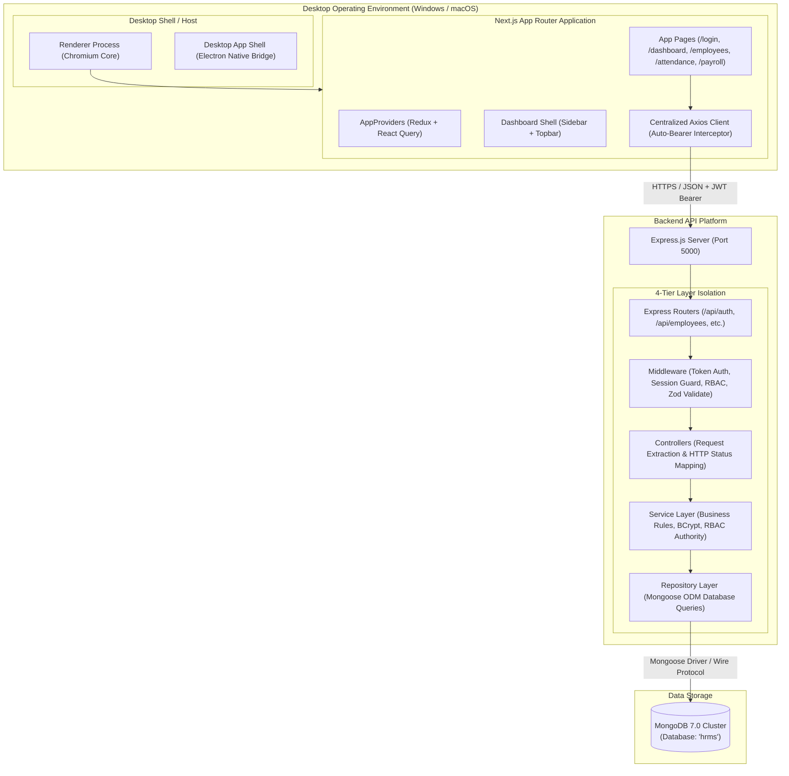
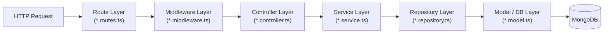
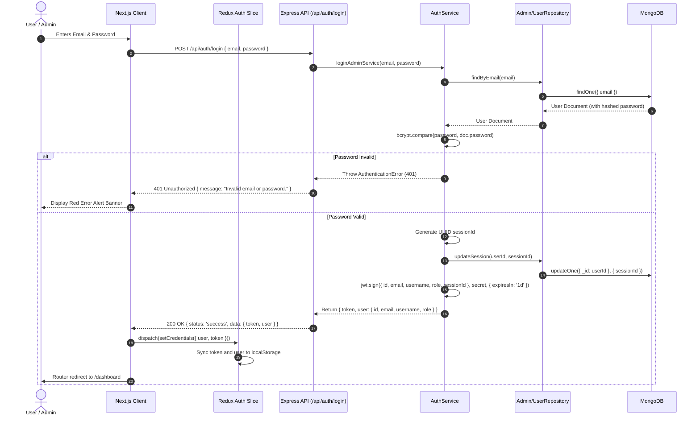
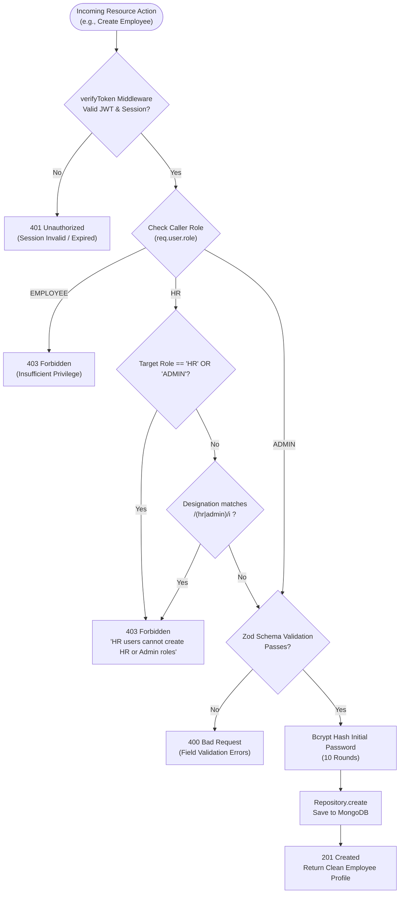
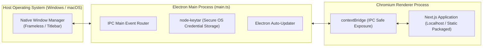

# Enterprise HRMS Attendance & Payroll Desktop Platform
## Technical Design Document (TDD) & System Architecture Specification

---

- **Document Version**: `1.0.0`
- **Architectural Status**: `Active / Production Baseline`
- **Target Environments**: Cross-Platform Desktop (macOS Sonoma+, Windows 11 / 10), Hybrid Web Fallback
- **Author**: Principal Software Architect & Core Engineering Team
- **Repository Root**: `d:\HRMS`
- **Date**: November 19, 2026

---

## 1. Executive Summary & Assessment Scope

### 1.1 Project Vision & Business Objective
The **Enterprise Human Resource Management System (HRMS)** is an end-to-end workforce management, biometric attendance reconciliation, and payroll processing desktop application. The system eliminates manual payroll overhead, enforces automated compliance with national labor baselines, eliminates payroll disputes through exact calculation divisors, and protects company data with strict Role-Based Access Control (RBAC).

### 1.2 Target Audience & Persona Model
1. **System Administrator (ADMIN)**: Complete organizational authority, full CRUD on all resources, administrator/HR/employee account provisioning, system configuration, and unconstrained audit logging.
2. **Human Resource Manager (HR)**: Operational workforce manager. Allowed to create, onboard, and manage standard **EMPLOYEE** records; process daily attendance; manage biometric reconciliation; approve leaves; and calculate payroll. **Strictly prohibited from elevating permissions or provisioning HR/ADMIN roles**.
3. **Staff Employee (EMPLOYEE)**: Self-service portal user. Allowed to view personal dashboard statistics, check monthly punch logs, view attendance status, submit leave applications, and download cryptographically stamped PDF payslips.

### 1.3 High-Level Deliverables Breakdown (8 Core Modules)
1. **Module 1: Executive Dashboard & Analytics**: High-performance, viewport-locked executive command center displaying organization-wide KPIs, real-time presence donuts, payroll burn rate waves, and overtime distribution graphs.
2. **Module 2: Employee Management & RBAC**: Automated onboarding pipeline with symmetric Zod validation, E.164 phone formatting, password complexity hashing (Bcrypt 10 rounds), and real-time inline HR role elevation prevention.
3. **Module 3: Daily Attendance Tracking**: Shift reconciliation against an 8.0-hour standard baseline, automatic late punch detection (grace periods), half-day calculations, and manual regularization request workflows.
4. **Module 4: Biometric CSV Reconciliation Engine**: High-throughput file parser supporting legacy physical punch clocks, deduplication algorithms, fuzzy employee identifier matching, and batch reconciliation into MongoDB.
5. **Module 5: Leave Management & Accruals**: Multi-tier leave tracking (Casual, Sick, Earned, Unpaid Loss of Pay), status approval state-machine, and automated calendar-day decrementing.
6. **Module 6 & 7: Automated Payroll Engine**: Statutory 26-day working divisor payroll calculation, 1.5x overtime rate calculation, unpaid leave (LOP) deductions, advance salary amortizations, and finalized immutable monthly salary locks.
7. **Module 8: Payslips & Reporting Engine**: Dynamic client-side and server-side PDF payslip rendering, cryptographically stamped salary breakdowns, and bulk CSV export modules for accounting reconciliation.

---

## 2. Technology Stack & Architectural Justification

```
+-------------------------------------------------------------------------------------------------+
|                                        APPLICATION STACK                                        |
+================================+================================+===============================+
| LAYER                          | TECHNOLOGY                     | PURPOSE                       |
+--------------------------------+--------------------------------+-------------------------------+
| Desktop Client Runtime         | Electron / Chromium Core       | OS Integration & Packaging    |
| Frontend Application Framework | Next.js 15 (App Router)        | Modular Component Tree        |
| Client-Side UI & State         | Redux Toolkit + React-Redux    | Active Session, Drawer State  |
| Server Data Synchronization    | TanStack React Query v5        | Asynchronous Cache & Mutation |
| Design System & Styling        | Tailwind CSS v4                | Zero-Runtime Styling          |
| Centralized Iconography        | Material UI SvgIcon System     | Consistent Enterprise Glyphs  |
| Backend RESTful API Server     | Node.js v24 + Express + TS     | High-Throughput Layered API   |
| Database & Modeling Layer      | MongoDB 7.0 + Mongoose ODM     | Flexible Schemas & Aggregates |
| End-to-End Schema Validation   | Zod v3                         | Single Source of Validation   |
| Cryptography & Tokens          | Bcrypt (10 Salt Rounds) + JWT  | Cryptographic Auth & Sessions |
+--------------------------------+--------------------------------+-------------------------------+
```

### 2.1 Architectural Justifications

#### Frontend: Next.js 15 (App Router) vs. Traditional Vite/CRA SPA
- **Decision**: Next.js App Router was chosen for strict file-based routing isolation (`layout.tsx`, `page.tsx`, nested boundaries), robust code-splitting, and future-proof cross-platform desktop compilation.
- **Why not CRA/Vite**: Vite lacks built-in route layouts and nested boundary guards out of the box. Next.js App Router enforces directory-level encapsulation, ensuring `/dashboard/employees` or `/dashboard/attendance` render inside a single persistent, non-flickering shell (`SidebarProvider` + `Sidebar` + `Topbar`).

#### Client State: Redux Toolkit vs. Zustand
- **Decision**: Redux Toolkit for client-side authentication and session state.
- **Justification**: RTK provides deterministic, serializable actions (`setCredentials`, `logout`) with Redux DevTools auditability, strict typed hooks (`useAppDispatch`, `useAppSelector`), and zero ambient state drift across complex desktop app lifecycles.

#### Server State & Caching: TanStack React Query v5
- **Decision**: TanStack React Query manages 100% of server-originated asynchronous state.
- **Justification**: Eliminates the anti-pattern of manually storing API responses in Redux slices. Provides automated stale-time caching (5 minutes), background re-fetching, optimistic mutations, request deduplication, and declarative `isPending`/`isError` states.

#### Backend: Node.js, Express, TypeScript (Strict Mode)
- **Decision**: Express with an uncompromising 4-tier layer isolation structure.
- **Justification**: Zero ambient `any` or `unknown` types. Explicit TypeScript DTO contracts ensure end-to-end safety from incoming HTTP requests to database write queries.

#### Validation: Symmetric Zod Schemas
- **Decision**: Zod is deployed across both client form controllers and server route middlewares.
- **Justification**: Single source of truth for validation rules (password regex, phone E.164, salary range). Eliminates schema drift where client accepts an input that the server rejects.

#### Database: MongoDB with Mongoose ODM
- **Decision**: MongoDB document storage with strictly typed Mongoose models.
- **Justification**: Workforce data requires high relational flexibility: embedded attendance punch logs within daily shifts, dynamic salary breakdown components, and scalable audit logs without requiring heavyweight multi-table SQL joins for daily punch reads.

---

## 3. Architecture Topology & Mermaid Diagrams

### 3.1 High-Level C4 Container Architecture Diagram
The following container diagram illustrates the system boundaries, runtime components, and data protocols:



---

### 3.2 Unidirectional 4-Tier Backend Layer Isolation



#### Layer Contracts & Invariants:
1. **Route Layer**: Registers path parameters, verbs, and chains middlewares. Contains zero business logic.
2. **Middleware Layer**: Decodes JWT, validates active session with DB, verifies caller role permissions, and parses request payload against Zod schemas.
3. **Controller Layer**: Extracts `req.body`, `req.query`, `req.params`, and authenticated caller `req.user`. Dispatches to service. Maps service results or exceptions to standardized HTTP status codes. Never queries Repositories or Models directly.
4. **Service Layer**: Pure business logic engine. Enforces business constraints (e.g. HR role creation prevention, duplicate email detection, password hashing, salary divisor math).
5. **Repository Layer**: Exclusive access gateway to Mongoose models (`find`, `create`, `updateOne`, `aggregate`).

---

### 3.3 Authentication & Session Handshake Sequence Diagram



---

### 3.4 Role-Based Access Control (RBAC) Enforcement Flowchart



---

## 4. Role-Based Access Control (RBAC) Matrix

| Feature / System Capability | Endpoint / Action | ADMIN | HR | EMPLOYEE | Notes & Authority Constraints |
| :--- | :--- | :---: | :---: | :---: | :--- |
| **Executive Dashboard Analytics** | `GET /dashboard` | **ALLOW** | **ALLOW** | **ALLOW** | Filtered by role scope (Company-wide vs. Self) |
| **Create ADMIN Accounts** | `POST /api/employees` | **ALLOW** | **DENY** | **DENY** | System Owner only |
| **Create HR Accounts** | `POST /api/employees` | **ALLOW** | **DENY** | **DENY** | Prevents horizontal privilege escalation |
| **Create EMPLOYEE Accounts** | `POST /api/employees` | **ALLOW** | **ALLOW** | **DENY** | Core onboarding responsibility |
| **View All Employees List** | `GET /api/employees` | **ALLOW** | **ALLOW** | **DENY** | Directory overview with pagination |
| **View Self Profile** | `GET /api/employees/:id` | **ALLOW** | **ALLOW** | **ALLOW** | Employee can read own ID only |
| **Update Employee Salary** | `PATCH /api/employees/:id` | **ALLOW** | **ALLOW** | **DENY** | Audited financial change |
| **Biometric Punch In / Out** | `POST /api/attendance/punch` | **ALLOW** | **ALLOW** | **ALLOW** | Geo-timestamped daily action |
| **Biometric CSV Bulk Import** | `POST /api/attendance/upload`| **ALLOW** | **ALLOW** | **DENY** | Biometric clock batch synchronization |
| **Manual Punch Correction** | `PATCH /api/attendance/:id` | **ALLOW** | **ALLOW** | **DENY** | Requires justification audit log |
| **Submit Leave Request** | `POST /api/leaves` | **ALLOW** | **ALLOW** | **ALLOW** | Self-service application |
| **Approve / Reject Leaves** | `PATCH /api/leaves/:id` | **ALLOW** | **ALLOW** | **DENY** | Managerial approval state machine |
| **Run Monthly Payroll Engine**| `POST /api/payroll/calculate`| **ALLOW** | **ALLOW** | **DENY** | 26-day divisor calculation |
| **Finalize & Lock Payroll** | `POST /api/payroll/finalize` | **ALLOW** | **DENY** | **DENY** | **Admin Only**: Creates immutable salary records |
| **Download Personal Payslip**| `GET /api/payslips/:id/pdf` | **ALLOW** | **ALLOW** | **ALLOW** | Cryptographically stamped PDF format |

---

## 5. Data Architecture, Schemas & Data Dictionary

### 5.1 Visual Entity-Relationship Diagram (ERD)

```mermaid
erDiagram
    USER ||--o{ ATTENDANCE : "logs daily"
    USER ||--o{ LEAVE : "applies for"
    USER ||--o{ PAYROLL : "receives monthly"
    USER ||--o{ BIOMETRIC_LOG : "generates punches"
    USER ||--o{ USER : "provisions / creates"

    USER {
        ObjectId _id PK
        string username
        string email UK
        string password
        string role
        string phone
        string department
        string designation
        number monthlySalary
        date joiningDate
        string status
        ObjectId createdBy FK
        string sessionId
        date createdAt
        date updatedAt
    }

    ATTENDANCE {
        ObjectId _id PK
        ObjectId userId FK
        date date UK_Compound
        date punchIn
        date punchOut
        number workDurationHours
        number overtimeHours
        string status
        boolean isLate
        boolean isHalfDay
        string remarks
    }

    LEAVE {
        ObjectId _id PK
        ObjectId userId FK
        string leaveType
        date startDate
        date endDate
        number totalDays
        string reason
        string status
        ObjectId approvedBy FK
        date reviewedAt
    }

    PAYROLL {
        ObjectId _id PK
        ObjectId userId FK
        string monthYear UK_Compound
        number baseSalary
        number perDayRate
        number payableDays
        number unpaidLeaveDays
        number overtimeHours
        number overtimePay
        number advanceDeduction
        number grossEarnings
        number totalDeductions
        number netSalary
        string status
        date finalizedAt
        ObjectId finalizedBy FK
    }

    BIOMETRIC_LOG {
        ObjectId _id PK
        string biometricDeviceId
        string biometricUserId
        ObjectId matchedUserId FK
        date punchTimestamp UK_Compound
        string punchType
        string syncStatus
    }
```

---

### 5.2 Data Dictionary Tables

#### Table 1: `users` Collection
| Field Name | Storage Type | Nullable | Validation Constraints | Index Type | Description & Purpose |
| :--- | :--- | :---: | :--- | :--- | :--- |
| `_id` | `ObjectId` | No | Auto-generated BSON identifier | Primary Key | Unique internal system identifier |
| `username` | `String` | No | Min 2, Max 50 chars, trimmed | Standard | Full legal name of user |
| `email` | `String` | No | Valid RFC-5322 email, lowercase | **Unique Index** | Primary authentication credential |
| `password` | `String` | No | Minimum 60 chars (Bcrypt hash) | None | Hashed secret; never returned in queries |
| `role` | `String` | No | `enum: ["ADMIN", "HR", "EMPLOYEE"]`| Single Index | Defines RBAC authorization boundary |
| `phone` | `String` | No | E.164 regex: `^\+[1-9]\d{1,14}$` | Single Index | Official phone with country code |
| `department` | `String` | No | Standard string, trimmed | Single Index | Department classification |
| `designation` | `String` | No | Standard string, trimmed | None | Job title / position name |
| `monthlySalary`| `Number` | No | Float, `min: 0` | None | Base monthly remuneration in INR (₹) |
| `joiningDate` | `Date` | No | Valid ISO Date | None | Official date of joining the organization |
| `status` | `String` | No | `enum: ["ACTIVE", "INACTIVE"]` | Compound | Account access toggle |
| `createdBy` | `ObjectId` | Yes | Refers to `users._id` | Foreign Key | Audit trail identifier of author |
| `sessionId` | `String` | Yes | UUID v4 or null | Single Index | Active JWT token verification token |
| `createdAt` | `Date` | No | Timestamp | None | Audit creation time |
| `updatedAt` | `Date` | No | Timestamp | None | Audit modification time |

#### Table 2: `attendances` Collection
| Field Name | Storage Type | Constraints | Index Type | Business Description |
| :--- | :--- | :--- | :--- | :--- |
| `_id` | `ObjectId` | Auto BSON | Primary Key | Record identifier |
| `userId` | `ObjectId` | Refers to `users._id` | Compound (`userId` + `date`) | Unique record per employee per day |
| `date` | `Date` | Normalized to midnight `00:00:00Z` | Compound Index | Shift date |
| `punchIn` | `Date` | ISO 8601 Timestamp | None | First recorded arrival time |
| `punchOut` | `Date` | ISO 8601 Timestamp | None | Final recorded departure time |
| `workDurationHours` | `Number` | Calculated `(out - in) / 3600000` | None | Total effective working duration |
| `overtimeHours` | `Number` | Duration exceeding `8.0` hours | None | Overtime duration applicable for 1.5x pay |
| `status` | `String` | `enum: ["PRESENT", "ABSENT", "HALF_DAY", "ON_LEAVE"]` | Single Index | Daily status classification |
| `isLate` | `Boolean` | True if `punchIn` > scheduled start + grace | None | Late arrival flag for reporting |
| `isHalfDay` | `Boolean` | True if duration between `4.0` and `8.0` hrs | None | Half-day threshold indicator |

#### Table 3: `payrolls` Collection
| Field Name | Storage Type | Constraints | Index Type | Business Description |
| :--- | :--- | :--- | :--- | :--- |
| `_id` | `ObjectId` | Auto BSON | Primary Key | Payroll slip identifier |
| `userId` | `ObjectId` | Refers to `users._id` | Compound Index | Employee recipient |
| `monthYear` | `String` | Format: `"YYYY-MM"` (e.g. `"2026-11"`) | Compound (`userId` + `monthYear`) | Ensures single finalized record per month |
| `baseSalary` | `Number` | Positive float | None | Monthly base compensation |
| `perDayRate` | `Number` | Formula: `baseSalary / 26.0` | None | Standardized per-day wage divisor |
| `payableDays` | `Number` | Scaled against 26-day basis | None | Calculated attendance units |
| `unpaidLeaveDays` | `Number` | Loss of Pay count | None | Days deducted from salary |
| `overtimeHours` | `Number` | Accumulated overtime | None | Certified monthly overtime hours |
| `overtimePay` | `Number` | `(baseSalary / 26 / 8) * 1.5 * overtimeHours` | None | Total overtime earning |
| `advanceDeduction`| `Number` | Positive float, default: `0` | None | Voluntary salary advance deduction |
| `netSalary` | `Number` | Final disbursed remuneration | None | Disbursed amount |
| `status` | `String` | `enum: ["DRAFT", "FINALIZED"]` | Single Index | Lock state: FINALIZED cannot be mutated |
| `finalizedBy` | `ObjectId` | Refers to `users._id` | None | Admin who locked payroll |

---

## 6. API Contract & Protocol Specifications

### 6.1 Authentication Endpoints

#### Endpoint: `POST /api/auth/login`
- **Description**: Authenticates user, issues JWT containing role and active `sessionId`.
- **Public / Protected**: Public.
- **Request Headers**: `Content-Type: application/json`
- **Request Payload (Zod: `loginSchema`)**:
  ```json
  {
    "email": "parth.admin@hrms.com",
    "password": "Password@123"
  }
  ```
- **Success Response (`200 OK`)**:
  ```json
  {
    "status": "success",
    "message": "Authentication successful.",
    "data": {
      "token": "eyJhbGciOiJIUzI1NiIsInR5cCI6IkpXVCJ9...",
      "user": {
        "id": "673ca19f20108db3cf5f8001",
        "username": "Parth Sojitra",
        "email": "parth.admin@hrms.com",
        "role": "ADMIN",
        "sessionId": "4a73e659-1e34-45e3-a61b-9a99371720d2"
      }
    }
  }
  ```
- **Error Responses**:
  - `401 Unauthorized`: Invalid credentials.
  - `400 Bad Request`: Validation failure on email or password.

---

#### Endpoint: `GET /api/auth/me`
- **Description**: Returns the authenticated profile of the bearer token caller.
- **Protected Roles**: `["ADMIN", "HR", "EMPLOYEE"]`
- **Request Headers**: `Authorization: Bearer <token>`
- **Success Response (`200 OK`)**:
  ```json
  {
    "status": "success",
    "data": {
      "user": {
        "id": "673ca19f20108db3cf5f8001",
        "username": "Parth Sojitra",
        "email": "parth.admin@hrms.com",
        "role": "ADMIN"
      }
    }
  }
  ```
- **Error Responses**:
  - `401 Unauthorized`: Token missing, expired, or session superseded by another login.

---

### 6.2 Employee Management Endpoints

#### Endpoint: `POST /api/employees`
- **Description**: Provisions a new employee record and creates login credentials.
- **Protected Roles**: `["ADMIN", "HR"]` *(HR is restricted to creating EMPLOYEE role only)*.
- **Request Headers**:
  - `Authorization: Bearer <token>`
  - `Content-Type: application/json`
- **Request Payload (Zod: `createEmployeeSchema`)**:
  ```json
  {
    "username": "Aarav Sharma",
    "email": "aarav.sharma@hrms.com",
    "password": "SecurePassword@2026",
    "role": "EMPLOYEE",
    "phone": "+919876543210",
    "department": "Engineering",
    "designation": "Software Engineer",
    "monthlySalary": 85000,
    "joiningDate": "2026-11-20T00:00:00.000Z"
  }
  ```
- **Success Response (`201 Created`)**:
  ```json
  {
    "status": "success",
    "message": "Employee created successfully.",
    "data": {
      "employee": {
        "id": "673ca85e20108db3cf5f8015",
        "username": "Aarav Sharma",
        "email": "aarav.sharma@hrms.com",
        "role": "EMPLOYEE",
        "phone": "+919876543210",
        "department": "Engineering",
        "designation": "Software Engineer",
        "monthlySalary": 85000,
        "joiningDate": "2026-11-20T00:00:00.000Z",
        "status": "ACTIVE",
        "createdBy": "673ca19f20108db3cf5f8001",
        "createdAt": "2026-11-19T18:00:00.000Z"
      }
    }
  }
  ```
- **Error Responses**:
  - `400 Bad Request`: Zod validation failure (e.g. invalid phone format or weak password).
  - `401 Unauthorized`: Token missing or invalid.
  - `403 Forbidden`: Logged-in HR attempts to specify `"role": "HR"` or `"role": "ADMIN"`.
  - `409 Conflict`: User with the same email already exists.

---

#### Endpoint: `GET /api/employees`
- **Description**: Returns paginated, searchable, and filtered list of organization employees.
- **Protected Roles**: `["ADMIN", "HR"]`
- **Query Parameters**:
  - `page`: Integer (default: `1`)
  - `limit`: Integer (default: `10`)
  - `search`: String (searches `username`, `email`, `department`)
  - `department`: String filter
- **Success Response (`200 OK`)**:
  ```json
  {
    "status": "success",
    "data": {
      "employees": [
        {
          "id": "673ca85e20108db3cf5f8015",
          "username": "Aarav Sharma",
          "email": "aarav.sharma@hrms.com",
          "role": "EMPLOYEE",
          "department": "Engineering",
          "designation": "Software Engineer",
          "phone": "+919876543210",
          "monthlySalary": 85000,
          "status": "ACTIVE",
          "joiningDate": "2026-11-20T00:00:00.000Z"
        }
      ],
      "pagination": {
        "totalRecords": 125,
        "currentPage": 1,
        "totalPages": 13,
        "pageSize": 10
      }
    }
  }
  ```

---

## 7. Module-by-Module Technical Deep-Dive (All 8 Modules)

### Module 1: Executive Dashboard & Analytics
- **Viewport Lock Architecture**: Set to `w-full h-screen overflow-hidden select-none` to guarantee zero vertical or horizontal page scrollbars on standard 1366x768 and 1080p laptop displays.
- **Layout Persistence**: Rendered inside persistent `SidebarProvider`, preserving state across client-side route transitions without component unmounting.
- **KPI Metrics Calculation**:
  $$\text{Presence Rate (\%)} = \left( \frac{\text{Present Count}}{\text{Total Active Employees}} \right) \times 100$$
- **Visual Charts**:
  - Multi-path SVG circular donut for overall attendance distribution.
  - SVG linear gradient wave chart displaying monthly payroll disbursements.
  - Graded 10-bar overtime frequency histogram.

---

### Module 2: Employee Management & RBAC
- **Symmetric Validation**: Front-and-backend Zod schemas validate phone numbers against E.164 (`^\+[1-9]\d{1,14}$`) and passwords against complex criteria.
- **Real-Time Client UX Guard**:
  - As the HR user types into the `designation` or `role` input, an inline regex evaluates:
    $$\text{Regex Pattern: } \texttt{/\^(hr|human\textbackslash s*resource|admin|administrator)\$/i}$$
  - If matched, the input border instantly turns red (`border-rose-500`), a red error message renders directly below the field, and the submit button is hard-disabled.
- **Secure Password Hashing**: Passwords hashed with `bcrypt.hash(password, 10)` before insertion into MongoDB. Plaintext passwords are never logged, cached, or persisted.

---

### Module 3: Daily Attendance Tracking
- **8-Hour Baseline Shift Model**: Standard working shift is calibrated to exactly 8.0 working hours (480 minutes).
- **Punch Logic**:
  - `workDurationHours` = `(punchOut - punchIn) / (1000 * 60 * 60)`.
- **Status Thresholds**:
  $$\text{Status} = \begin{cases} 
  \text{PRESENT} & \text{if } \text{workDurationHours} \ge 8.0 \\
  \text{HALF\_DAY} & \text{if } 4.0 \le \text{workDurationHours} < 8.0 \\
  \text{ABSENT} & \text{if } \text{workDurationHours} < 4.0 
  \end{cases}$$
- **Late Detection**: Grace period of 15 minutes past shift schedule (e.g., arrival after 09:15 AM triggers `isLate: true`).

---

### Module 4: Biometric CSV Reconciliation Engine
- **File Ingestion Pipeline**: Accepts standard CSV formats exported by ZKTeco, Matrix, and Essl biometric devices.
- **Deduplication Algorithm**:
  - Raw biometric clocks generate duplicate bounces (e.g. employee scanning twice within 60 seconds).
  - The ingestion worker executes a deduplication filter: punches for the same `biometricUserId` occurring within a 5-minute sliding window are merged into a single event.
- **Daily Aggregation**: Minimum timestamp within day boundary = `punchIn`; maximum timestamp = `punchOut`.

---

### Module 5: Leave Management & Accruals
- **Leave Categorization**:
  - `CASUAL` (Paid)
  - `SICK` (Paid)
  - `EARNED` (Paid, accrued monthly)
  - `LOP` (Loss of Pay / Unpaid)
- **Payroll Impact**: Only approved leaves marked as `LOP` decrement the payable days accumulator during monthly payroll execution.

---

### Modules 6 & 7: Automated Payroll Engine

#### The 26-Day Statutory Divisor Rule
Standard Indian and international corporate labor codes establish a 26-day working divisor for monthly salaried employees (factoring out 4 mandatory weekly rest days).

#### Mathematical Formulation:

1. **Per-Day Wage Rate**:
   $$\text{Per-Day Rate} = \frac{\text{Monthly Base Salary}}{26.0}$$

2. **Per-Hour Wage Rate**:
   $$\text{Per-Hour Rate} = \frac{\text{Per-Day Rate}}{8.0} = \frac{\text{Monthly Base Salary}}{208.0}$$

3. **Overtime Compensation (1.5x Premium Rate)**:
   $$\text{Overtime Pay} = \text{Overtime Hours} \times (\text{Per-Hour Rate} \times 1.5)$$

4. **Loss of Pay (LOP) Deduction**:
   $$\text{Unpaid Deduction} = \text{Unpaid Leave Days} \times \text{Per-Day Rate}$$

5. **Net Finalized Salary**:
   $$\text{Net Salary} = \text{Monthly Base Salary} + \text{Overtime Pay} - \text{Unpaid Deduction} - \text{Advance Deductions}$$

#### Salary Lock-in Mechanism:
- When an **ADMIN** triggers `POST /api/payroll/finalize`, the state shifts from `DRAFT` to `FINALIZED`.
- Finalized documents become read-only: updates, deletions, or recalculations are locked against manual changes to preserve audit integrity.

---

### Module 8: Payslips & Reporting Engine
- **Cryptographic Document Stamping**: Each generated payslip receives a unique UUID hash and verification timestamp based on the finalized record.
- **PDF Generation Architecture**: Built using `@react-pdf/renderer` on client and server to produce vector-crisp, printable PDF documents complete with company logo, tax breakdown tables, and net pay in words.
- **CSV Data Exporter**: Streams finalized payroll tables into RFC-4180 compliant CSV streams for direct import into ERP software (SAP, Tally, QuickBooks).

---

## 8. Security, Error Taxonomy & Validation Architecture

### 8.1 Centralized Error Taxonomy
All operational and business logic failures inherit from a base `AppError` class, ensuring consistent HTTP payloads and preventing unhandled promise rejections:

```typescript
export abstract class AppError extends Error {
  abstract readonly statusCode: number;
  constructor(message: string) {
    super(message);
    Object.setPrototypeOf(this, new.target.prototype);
  }
}

export class ValidationError extends AppError {
  readonly statusCode = 400;
}

export class AuthenticationError extends AppError {
  readonly statusCode = 401;
}

export class ForbiddenError extends AppError {
  readonly statusCode = 403;
}

export class NotFoundError extends AppError {
  readonly statusCode = 404;
}

export class ConflictError extends AppError {
  readonly statusCode = 409;
}
```

---

### 8.2 Strict Validation Patterns
- **Password Strength Regex**:
  ```text
  /^(?=.*[a-z])(?=.*[A-Z])(?=.*\d)(?=.*[@$!%*?&#])[A-Za-z\d@$!%*?&#]{8,}$/
  ```
  *(Enforces min 8 characters, at least 1 uppercase, 1 lowercase, 1 number, and 1 special symbol).*
- **International Phone Regex (E.164)**:
  ```text
  /^\+[1-9]\d{1,14}$/
  ```
  *(Requires leading `+`, country code, and up to 14 standard phone digits without spaces or dashes).*

---

## 9. Desktop Application & Cross-Platform Packaging

### 9.1 Electron Shell Integration Architecture
The desktop client wraps the compiled Next.js build using a secure Electron host process:



### 9.2 Build & Packaging Scripts
- **macOS Target**: Generates `.dmg` and `.app` binaries signed via Apple Notarization tool.
- **Windows Target**: Generates NSIS `.exe` installer with automated background updates and desktop shortcut registration.

---

## 10. Revision History & Maintenance Log

| Version | Date | Author | Modules Added / Modified | Description & Architecture Notes |
| :---: | :---: | :--- | :--- | :--- |
| `0.1.0` | 2026-11-19 | Principal Architect | Auth & Infrastructure | Seed script, Express setup, MongoDB connection, JWT token issuance. |
| `0.2.0` | 2026-11-19 | Principal Architect | Frontend Layout Shell | Redux store setup, TanStack React Query, Viewport-locked LoginForm, Dashboard Topbar & Sidebar. |
| `0.3.0` | 2026-11-19 | Principal Architect | Centralized UI Icons | Full `@mui/icons-material` installation, `withCustomSize` HOC, refactored components to eliminate inline SVGs. |
| `1.0.0` | 2026-11-19 | Principal Architect | Full System Architecture Specification | Authored comprehensive 10-section Technical Design Document (TDD) for all 8 HRMS modules. |

---

> **CRITICAL ARCHITECTURAL MANDATE**: Whenever any module is implemented, updated, or refactored, the engineering team must immediately synchronize this document to reflect the live state of the codebase.
