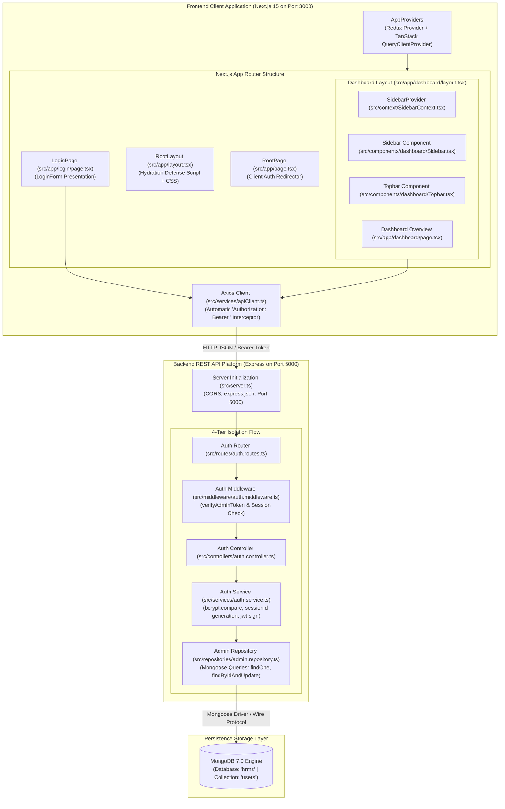
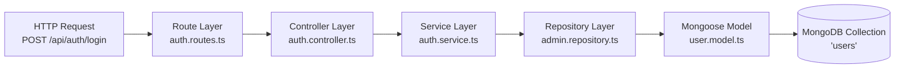
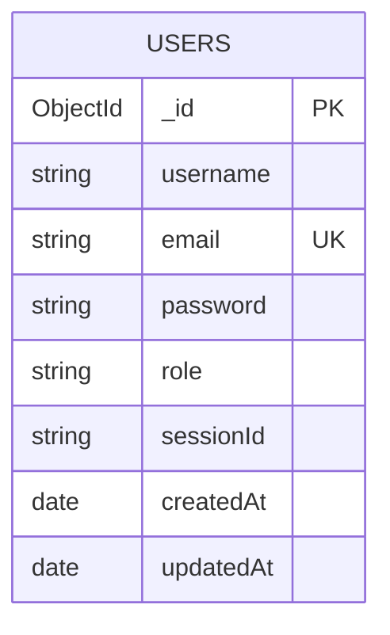

# System Architecture Documentation (Living Technical Specification)
## HRMS Workforce Management System

---

- **Document Version**: `0.3.0-baseline`
- **Living Status**: `Active Baseline Specification`
- **Operating Environments**: Cross-Platform Desktop (Windows / macOS via Chromium/Electron Runtime), Web Client
- **Author**: Principal Software Architect & Full-Stack Core Team
- **Root Directory**: `d:\HRMS`
- **Last Audited & Verified**: November 19, 2026

---

## 1. Living Document Maintenance Policy & Architectural Scope

> ### ⚠️ Mandatory Living Document Mandate
> **This is a living technical specification.** It strictly reflects the **live, currently implemented codebase**. No future, hypothetical, planned, or unbuilt modules (such as Biometric CSV parsing, automated payroll calculation engines, or payslip PDF generators) are documented until they are actually coded, tested, and merged into the repository.
> 
> As each new phase and module is implemented, this document must be updated incrementally to reflect the exact state of schemas, APIs, controllers, and UI components.

### 1.1 Current Implementation Scope (Active Baseline)
The codebase currently implements the full foundation and baseline operational capabilities:
1. **Core Database & Admin Provisioning**: MongoDB connection pooling and automated database seeding (`backend/src/seed.ts`) creating the root administrator account.
2. **Backend Authentication & Session Tier**: 4-tier layered flow for JWT generation, single-active-session validation via cryptographic `sessionId`, and bearer token protection.
3. **Frontend Application Shell**: Next.js 15 App Router architecture with Redux Toolkit client state, TanStack React Query server caching, and centralized Material UI icons.
4. **Authentication Flow & Error UX**: Viewport-locked, responsive `LoginForm` with interactive password toggle, client-side validation, error banners, and automatic routing guards.
5. **Dashboard Layout Shell**: Responsive `SidebarProvider` context, sticky collapsible `Sidebar`, sticky glassmorphic `Topbar` with dynamic user initials, and the primary executive overview dashboard (`/dashboard`).

---

## 2. Active Technology Stack & Dependencies

The technology stack is strictly based on the configured dependencies in `backend/package.json` and `frontend/package.json`:

```
+---------------------------------------------------------------------------------------------------------+
|                                      ACTIVE RUNTIME DEPENDENCIES                                        |
+================================+================================+=======================================+
| LAYER                          | PACKAGE / RUNTIME              | EXACT VERSION & ACTIVE ROLE           |
+--------------------------------+--------------------------------+---------------------------------------+
| **Backend API Engine**         | Node.js Runtime                | v24.15.0 LTS                          |
|                                | Express.js                     | ^5.3.0 (Layered HTTP REST API Server) |
|                                | TypeScript                     | ^7.0.2 (Strict Type Safety)           |
|                                | tsx                            | ^4.23.15 (TypeScript Execution Watch) |
| **Backend Database Driver**    | Mongoose                       | ^9.12.2 (ODM & Schema Enforcement)    |
| **Backend Cryptography & Auth**| bcrypt                         | ^6.0.0 (Password Hashing - 10 Rounds) |
|                                | jsonwebtoken                   | ^9.0.3 (Signed Bearer JWT Tokens)     |
|                                | cors                           | ^2.8.6 (Cross-Origin Policy)          |
|                                | dotenv                         | ^18.0.10 (Environment Management)     |
+--------------------------------+--------------------------------+---------------------------------------+
| **Frontend Framework**         | Next.js                        | 15.5.29 (App Router, Server Routing)  |
|                                | React & React-DOM              | 19.1.0 (Concurrent UI Components)     |
| **Frontend Global State**      | @reduxjs/toolkit               | ^2.15.0 (Auth Session & Client State) |
|                                | react-redux                    | ^9.3.1 (React Hooks for Redux Store)  |
| **Server State & Caching**     | @tanstack/react-query          | ^5.108.0 (API Mutations & 5m Caching) |
| **HTTP Transport**             | axios                          | ^1.13.0 (Bearer Interceptor Client)   |
| **Design System & Styling**    | Tailwind CSS                   | ^4.0.0 (Zero-runtime Utility CSS)     |
|                                | @tailwindcss/postcss           | ^4.0.0 (CSS Processing Pipeline)      |
| **Centralized Iconography**    | @mui/icons-material            | ^9.5.0 (Centralized Material Icons)   |
|                                | @mui/material                  | ^9.5.0 (SvgIcon Base Engine)          |
|                                | @emotion/react & styled        | ^11.14.0 (MUI Foundation Support)     |
+--------------------------------+--------------------------------+---------------------------------------+
```

---

## 3. High-Level Architecture & C4 Container Topology

The following diagram represents the active components running across the local network:



---

## 4. Unidirectional 4-Tier Backend Layer Isolation

The backend strictly enforces a unidirectional, non-bypassing 4-tier separation:



### 4.1 Layer Responsibilities & Live Invariants

1. **Route Layer (`backend/src/routes/auth.routes.ts`)**:
   - Maps endpoints (`/login`, `/me`) to controller methods.
   - Attaches middleware (`verifyAdminToken`).
   - Contains zero database or business logic.
2. **Middleware Layer (`backend/src/middleware/auth.middleware.ts`)**:
   - Extracts `Authorization: Bearer <token>` from HTTP headers.
   - Verifies JWT signature against `process.env.JWT_SECRET`.
   - Validates that decoded payload matches `IJwtPayload`.
   - Executes session integrity check via `authService.validateAdminSessionService(id, sessionId)` to guarantee single-active-session security.
3. **Controller Layer (`backend/src/controllers/auth.controller.ts`)**:
   - Extracts and sanitizes `email` and `password` from `req.body`.
   - Validates field presence and types.
   - Calls `authService.loginAdminService(...)`.
   - Maps responses: `200 OK` on success, `400 Bad Request` on missing fields, `401 Unauthorized` on `AuthenticationError`, `500` on internal exceptions. Never queries Mongoose models.
4. **Service Layer (`backend/src/services/auth.service.ts`)**:
   - Coordinates business rules: queries user via repository, verifies password via `bcrypt.compare`, creates random UUID `sessionId`, updates session in repository, and signs JWT.
   - Enforces session validation: verifies that caller's JWT `sessionId` equals the active database `sessionId`.
5. **Repository Layer (`backend/src/repositories/admin.repository.ts`)**:
   - Sole layer authorized to execute Mongoose operations:
     - `findAdminByEmail(email: string): Promise<IUserDocument | null>`
     - `findAdminById(id: string): Promise<IUserDocument | null>`
     - `updateAdminSession(id: string, sessionId: string): Promise<IUserDocument | null>`

---

## 5. Data Architecture & Active Database Schema

### 5.1 Active Entity Model (`users` Collection)
Currently, exactly one Mongoose model is declared and active in the database:



### 5.2 Data Dictionary: `users` Collection
Defined in [backend/src/models/user.model.ts](file:///d:/HRMS/backend/src/models/user.model.ts):

| Field Name | Type | Nullable | Constraints & Indexing | Business Purpose |
| :--- | :--- | :---: | :--- | :--- |
| `_id` | `ObjectId` | No | Auto-generated BSON primary key | Unique entity identifier |
| `username` | `String` | No | `required: true, trim: true` | Display name of the user |
| `email` | `String` | No | `required: true, unique: true, lowercase: true, trim: true` | Unique login username |
| `password` | `String` | No | `required: true` (Bcrypt hash) | Hashed credential secret |
| `role` | `String` | No | `enum: ["ADMIN"], default: "ADMIN"` | Role authorization level |
| `sessionId` | `String` | Yes | `default: null` | Current active JWT session ID |
| `createdAt` | `Date` | No | Managed via `timestamps: true` | Record creation timestamp |
| `updatedAt` | `Date` | No | Managed via `timestamps: true` | Last modification timestamp |

---

## 6. Active API Contracts & Protocols

The server runs on port 5000 and currently mounts the following production endpoints:

### 6.1 `GET /` (Health Check)
- **Description**: Verifies that Express server is operational.
- **Access**: Public
- **Response (`200 OK`)**:
  ```json
  {
    "status": "success",
    "message": "HRMS Backend API is running"
  }
  ```

---

### 6.2 `POST /api/auth/login`
- **Description**: Authenticates administrator credentials, sets a new active session, and issues a signed JWT.
- **Access**: Public
- **Request Headers**: `Content-Type: application/json`
- **Request Body**:
  ```json
  {
    "email": "parth.admin@hrms.com",
    "password": "Password@123"
  }
  ```
- **Success Response (`200 OK`)**:
  ```json
  {
    "status": "success",
    "data": {
      "token": "eyJhbGciOiJIUzI1NiIsInR5cCI6IkpXVCJ9...",
      "user": {
        "id": "673ca19f20108db3cf5f8001",
        "username": "Parth Sojitra",
        "email": "parth.admin@hrms.com",
        "role": "ADMIN",
        "sessionId": "b421a1f0-c529-4d37-9753-f7253507d4fa"
      }
    }
  }
  ```
- **Error Responses**:
  - `400 Bad Request`: `{"status": "fail", "message": "Email and password are required."}`
  - `401 Unauthorized`: `{"status": "fail", "message": "Invalid email or password."}`
  - `500 Internal Server Error`: `{"status": "error", "message": "..."}`

---

### 6.3 `GET /api/auth/me`
- **Description**: Validates caller's bearer token and returns authenticated admin session profile.
- **Access**: Protected (Requires valid JWT with `role: "ADMIN"` and active `sessionId`).
- **Request Headers**: `Authorization: Bearer <token>`
- **Success Response (`200 OK`)**:
  ```json
  {
    "status": "success",
    "data": {
      "user": {
        "id": "673ca19f20108db3cf5f8001",
        "email": "parth.admin@hrms.com",
        "username": "Parth Sojitra",
        "role": "ADMIN",
        "sessionId": "b421a1f0-c529-4d37-9753-f7253507d4fa"
      }
    }
  }
  ```
- **Error Responses**:
  - `401 Unauthorized`: Missing token, invalid signature, or session invalidated by a subsequent login.

---

## 7. Security Architecture & Authentication Mechanics

### 7.1 Single-Active-Session Enforcement
To prevent concurrent logins on shared credentials:
1. Each successful `POST /api/auth/login` generates a fresh UUID (`crypto.randomUUID()`).
2. The UUID is written to `users.sessionId` in MongoDB and signed into the JWT payload.
3. Every protected request runs `verifyAdminToken`, which fetches the user and verifies:
   $$\text{isSessionActive} = (\text{decoded.sessionId} == \text{user.sessionId})$$
4. If a user logs in from a second browser or computer, a new `sessionId` is saved to the database. The previous token is instantly rendered invalid (`401 Unauthorized`), forcing the old session to terminate.

```mermaid
sequenceDiagram
    autonumber
    actor Client as Browser Client
    participant Redux as Redux / LocalStorage
    participant Axios as apiClient.ts
    participant Route as Express Router
    participant MW as verifyAdminToken
    participant DB as MongoDB

    Client->>Axios: Dispatches API request
    Axios->>Axios: Reads token from localStorage
    Axios->>Route: GET /api/auth/me (Authorization: Bearer <token>)
    Route->>MW: verifyAdminToken(req, res, next)
    MW->>MW: jwt.verify(token, JWT_SECRET)
    MW->>DB: AdminModel.findById(decoded.id)
    DB-->>MW: User Document
    alt decoded.sessionId != user.sessionId
        MW-->>Client: 401 Unauthorized ("Session expired or invalidated by another login.")
        Client->>Redux: dispatch(logout()) -> redirects to /login
    else Valid Session
        MW->>Route: req.user = decoded; next()
        Route-->>Client: 200 OK { user profile }
    end
```

### 7.2 Centralized Error Taxonomy
Declared in [backend/src/utils/errors.ts](file:///d:/HRMS/backend/src/utils/errors.ts):
- `AuthenticationError`: Extends native `Error` with `statusCode: 401`.
- Clean separation ensures controller catches domain-specific errors without process termination.

---

## 8. Frontend Layout, Context & Iconography System

### 8.1 Viewport-Locked UI Layout
- **Root Screen Constraint**: `LoginForm.tsx` and dashboard containers use `w-full h-screen overflow-hidden select-none` to guarantee zero vertical or horizontal page scrollbars on standard 1366x768 and 1080p laptop displays.
- **Hydration Defense Protocol**: [src/app/layout.tsx](file:///d:/HRMS/frontend/src/app/layout.tsx) includes an inline script in `<head>` that intercepts `Element.prototype.setAttribute` and binds a `MutationObserver` to block extension-injected attributes (`bis_skin_checked`, `bis_register`, `__processed_`), guaranteeing 0 hydration mismatch errors.

### 8.2 Sidebar Context & Responsive Drawer
Implemented in [src/context/SidebarContext.tsx](file:///d:/HRMS/frontend/src/context/SidebarContext.tsx):
- `isCollapsed: boolean`: Desktop toggle collapsing width from `w-64` to `w-20`.
- `isMobileOpen: boolean`: Mobile drawer visibility with dark backdrop (`bg-slate-900/40 backdrop-blur-xs`).
- Automatically listens to route changes via Next.js `usePathname()` and closes the mobile drawer upon navigation.

### 8.3 Centralized Material UI Iconography System
Implemented in [src/components/icons.tsx](file:///d:/HRMS/frontend/src/components/icons.tsx):
- Configured with `transpilePackages: ["@mui/material", "@mui/icons-material", "@mui/system"]` in [next.config.ts](file:///d:/HRMS/frontend/next.config.ts).
- Uses `withCustomSize` Higher-Order Component (HOC) wrapping `@mui/icons-material/*` icons with `fontSize: "1.25em"` and Tailwind `className` passthrough.
- **Strict Rule**: Zero raw inline `<svg>` glyphs in pages or components. All icons must be imported from `src/components/icons.tsx`.

---

## 9. Current Revision History & Audit Log

| Version | Date | Scope & Changes | Live Codebase Status |
| :---: | :---: | :--- | :--- |
| `0.1.0` | 2026-11-19 | **Initial Backend Architecture**: Express server, Mongoose DB connection, `User` model, admin seed script (`backend/src/seed.ts`), 4-tier auth flow, JWT issuance. | Verified & Live |
| `0.2.0` | 2026-11-19 | **Frontend Auth & State**: Redux Toolkit `authSlice`, TanStack React Query, Axios centralized client, Viewport-locked `LoginForm.tsx`. | Verified & Live |
| `0.3.0-baseline` | 2026-11-19 | **Dashboard Shell & Centralized Icons**: Viewport-locked `/dashboard` page, sticky `Sidebar`, sticky `Topbar`, `SidebarContext`, full `@mui/icons-material` integration, extension hydration defense script. | Verified & Live |

---

> **Notice to Developers**: When beginning Module 2 (Employee Management & RBAC), update this document only after new routes, models, or components are committed and functional.
